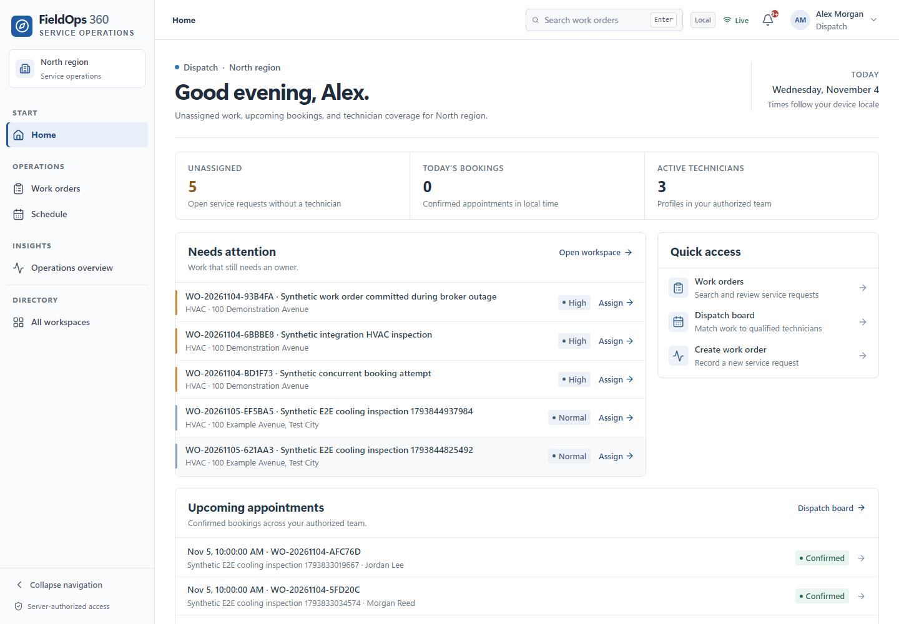
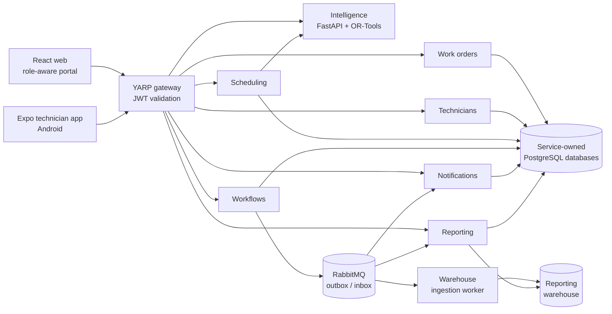
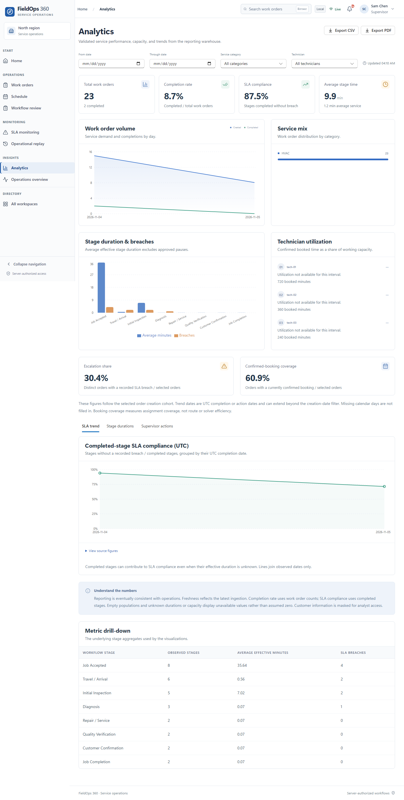
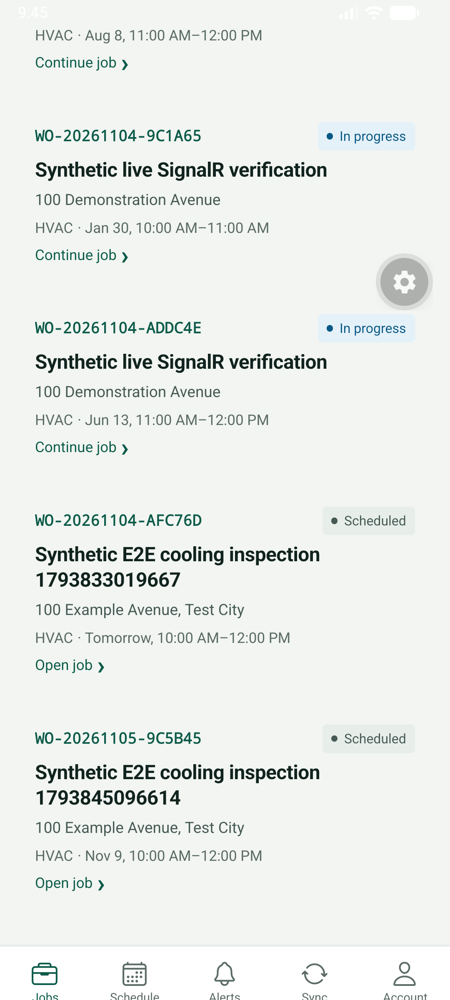

# FieldOps 360

FieldOps 360 is a local-first field-service operations platform for dispatch, guided HVAC work, SLA supervision, warehouse analytics, and incident replay. It combines six ASP.NET Core services, a React operations portal, an Expo technician app, PostgreSQL, RabbitMQ, Keycloak, and a Python intelligence service.

> **Status:** engineering demonstration with a verified local stack. There is no production deployment, certification, or real-customer data in this repository. All operational records and screenshots are synthetic.



## The problem

A regional service operation has to answer four questions without relying on spreadsheets or undocumented decisions:

- Who is qualified and available to take this work?
- Is the technician following the required procedure, and how much SLA time remains?
- Which jobs or stages need a supervisor decision now?
- What actually happened when an incident is investigated later?

FieldOps 360 keeps those answers in service-owned records. Dispatch validates availability and qualifications, workflow state and SLA deadlines are server-authoritative, supervisor actions retain their reasons, and replay reconstructs history without re-executing commands.

## Implemented capabilities

| Area | Working behavior |
|---|---|
| Role-aware Home | A separate landing view for Technician, Dispatcher, Supervisor, Operations Manager, Analyst, and Administrator, built from authorized API data. |
| Work orders | Search, status/priority filters, validated creation, details, optimistic version checks, and eligible cancellation. |
| Scheduling | Scoped availability, baseline and OR-Tools recommendations, confirmed-booking overlap protection, rescheduling, and reasoned cancellation. |
| Guided service | Eight-stage HVAC workflow with versioned server forms, conditional fields, drafts, assistance, idempotent submissions, and read-only history. |
| SLA control | Persisted 20/25/30-minute warning, critical, and breach milestones; approved pauses; restart-safe sweeps. |
| Supervision | At-risk queues, persistent alerts, acknowledgment, pause/resume, overrides, and advisory risk review with recorded decisions. |
| Analytics | Warehouse-backed completion, SLA, duration, volume, category, and utilization metrics with filters, definitions, and CSV/PDF exports. |
| Operational replay | Read-only timeline, retries, delivery evidence, ordering uncertainty, trace availability checks, playback, and incident exports. |
| Technician mobile | Expo/React Native jobs, schedule, guided forms, SecureStore PKCE, durable offline drafts, and a conflict-aware synchronization queue. |
| Identity | Keycloak Authorization Code + PKCE with signed realm roles and team claims enforced again by every backend service. |

## Architecture



Each business service owns its database and runtime identity. Critical writes commit business state and an outbox event together; consumers deduplicate stable event IDs. Reporting reads a separate warehouse through a read-only identity and keeps replay evidence append-only.

### Services

| Component | Responsibility |
|---|---|
| `services/work-orders` | Service-request lifecycle, validation, versioning, and integration events. |
| `services/technicians` | Team profiles, skills, certifications, hours, availability, and time off. |
| `services/scheduling` | Candidate validation, optimization advice, booking, overlap protection, and cancellation. |
| `services/workflows` | Versioned forms, stage transitions, SLA state, assistance, and supervisor decisions. |
| `services/notifications` | Deduplicated alerts, acknowledgments, history, and SignalR updates. |
| `services/reporting` | Warehouse metrics/exports and immutable replay investigation. |
| `gateway` | Authenticated YARP ingress and readiness aggregation. |
| `intelligence` | Synthetic SLA prediction and scheduling-optimization evaluation. |

## Technology

- **Backend:** .NET 10 LTS, ASP.NET Core, EF Core, MassTransit/RabbitMQ, Quartz, PostgreSQL.
- **Web:** React 19, TypeScript, Vite, Fluent UI, TanStack Query, React Router, Recharts.
- **Mobile:** Expo SDK 58, React Native 0.88, Expo Router, SecureStore, AsyncStorage persistence.
- **Data and operations:** PostgreSQL, RabbitMQ, Keycloak, Docker Compose, Prometheus, Grafana, Jaeger.
- **Intelligence:** Python 3.14, FastAPI, scikit-learn, OR-Tools, pytest.

## Repository layout

```text
apps/web/                  React operations portal
apps/technician-mobile/    Expo technician application
services/                  Six ASP.NET Core service hosts
building-blocks/           Shared domain, persistence, security, and host code
gateway/                   Authenticated YARP ingress
analytics/                 Warehouse migrations, ingestion, and quality tests
intelligence/              SLA prediction and scheduling optimization
infrastructure/            Docker, Keycloak, PostgreSQL, and monitoring configuration
tests/                     Backend, integration, mobile, security, and warehouse tests
docs/                      Architecture, operations, security, UI/UX, and evidence
```

## Quick start

Prerequisites: Docker Compose v2 with Linux containers, Python 3.11+, and at least 8 GB available to Docker. Source development additionally uses .NET 10 LTS, Node 24, and Python 3.14.

```bash
python scripts/init-local.py
docker compose up -d --build
python scripts/wait-local.py
```

Open **http://localhost:8088** and choose **Continue to secure sign-in**. The generated local accounts are `technician`, `dispatcher`, `supervisor`, `manager`, `analyst`, and `administrator`. Their shared local password is the `DEMO_PASSWORD` value in the ignored root `.env`; it is never printed by the bootstrap or committed.

The first build can take several minutes. For prerequisites, source-development commands, tests, upgrades, monitoring, and troubleshooting, read the **[installation and operations guide](docs/INSTALLATION.md)**. The deeper runbook remains [LOCAL_DEPLOYMENT.md](docs/operations/LOCAL_DEPLOYMENT.md).

## Screenshots

| Role-aware Home | Warehouse analytics |
|---|---|
|  |  |



More role, responsive, replay, and accessibility evidence is indexed in [UI/UX documentation](docs/INDEX.md#uiux-and-accessibility).

## Verification

| Check | Latest local result |
|---|---|
| .NET backend tests (including PostgreSQL Testcontainers) | **57/57** passed |
| Web TypeScript, unit/component tests | Typecheck passed; **49/49** tests passed |
| Web production build | Passed; no >500 kB chunk warning |
| Expo TypeScript and tests | **23/23** tests passed |
| Intelligence tests and Ruff | **18/18** passed; Ruff clean |
| Live Playwright role/deep-link suite | **16/16** passed locally after the drawer fix |
| Accessibility | Prior axe-core run: **0 violations across 30 signed-out and authenticated views**; a fresh assistive-technology audit remains open |

Commands and evidence boundaries are recorded in [testing/VERIFICATION.md](docs/testing/VERIFICATION.md) and [engineering/REFACTORING_RESULTS.md](docs/engineering/REFACTORING_RESULTS.md). Passing tests here are local evidence, not a claim of a remote CI run or production readiness.

## Documentation

- [Installation, tests, and operations](docs/INSTALLATION.md)
- [Documentation index](docs/INDEX.md)
- [System architecture](docs/architecture/overview.md)
- [Security and role boundaries](docs/security/threat-model.md)
- [API and event contracts](docs/architecture/contracts.md)
- [Workflow and SLA design](docs/workflows/design.md)
- [Implementation status and open items](docs/IMPLEMENTATION_STATUS.md)
- [UI walkthrough](docs/UI_WALKTHROUGH.md)
- [Engineering baseline and refactoring evidence](docs/engineering/REFACTORING_BASELINE.md)

## Security and limitations

Local endpoints bind to loopback and use generated development credentials. Do not reuse them. Production requires TLS, managed secrets and rotation, MFA/device policy, retention and backup exercises, and a deployment-specific threat review. See [SECURITY.md](SECURITY.md).

Known limits include: no remote CI run is claimed; guided stage submission and offline recovery were not completed on a native device; the native app has no physical-device certification; Jaeger retention is in-memory; the SLA model is trained and evaluated on synthetic data and is advisory only; and cross-service workflows are not distributed serializable transactions. The complete list is maintained in [IMPLEMENTATION_STATUS.md](docs/IMPLEMENTATION_STATUS.md).

## License

[MIT](LICENSE).
