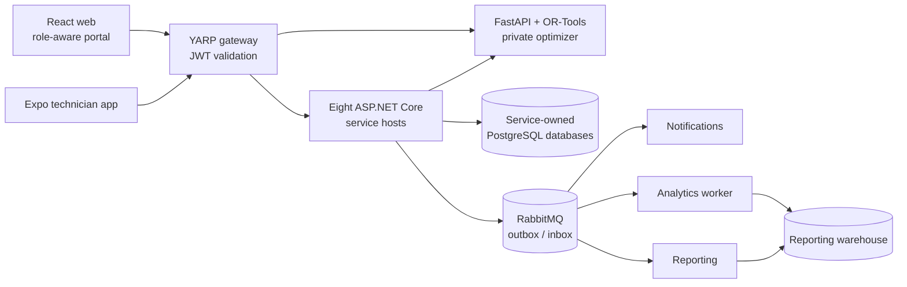

# FieldOps 360

FieldOps 360 is a local-first field-service operations platform for qualified dispatch, guided HVAC service work, server-enforced SLA supervision, warehouse analytics, and immutable incident replay. It combines eight ASP.NET Core service hosts, a YARP gateway, a React operations portal, an Expo technician app, PostgreSQL, RabbitMQ, Keycloak, and a deterministic OR-Tools scheduling service.

The project is an engineering demonstration with a verified local stack, a scoped customer portal, and a native Android offline verification path. It does not claim a production deployment, physical-device certification, or real-customer data. The current implementation audit and remaining enterprise scope are recorded in [Business operations](docs/BUSINESS_OPERATIONS.md).

## The problem

A service operation has to decide who is qualified and available, whether a technician is following the required procedure, which jobs need escalation, and what evidence exists after an incident. FieldOps 360 keeps those answers in service-owned records:

- dispatch validates skills, certifications, hours, time off, and overlap before booking;
- workflow state and SLA deadlines are server-authoritative;
- supervisor interventions retain a reason and enter the audit stream;
- replay reconstructs history from immutable events without re-executing commands.

## Capabilities

| Area | Implemented behavior |
|---|---|
| Identity | Keycloak Authorization Code + PKCE with signed realm roles and team claims. |
| Customers | Team-scoped customers, contacts, consent, locations, versioned history. |
| Equipment | Asset hierarchy, serial/QR identity, warranty, location history, assigned service history. |
| Work orders | Search, filtering, validated creation, customer/asset links, optimistic versions, eligible cancellation. |
| Scheduling | Baseline and OR-Tools CP-SAT recommendations, availability/skills validation, booking, rescheduling, conflict protection. |
| Customer intake | Customer-scoped requests, dispatcher qualification, linked orders, appointment tracking and completed service reports. |
| Assignment offers | Exclusive invitations, expiry/decline/revoke, online acceptance, transactional booking, durable scheduling revisions. |
| Guided service | Eight-stage workflow, conditional fields, drafts, assistance, idempotent submissions, read-only history. |
| SLA | Persisted warning, critical, and breach milestones; approved pauses; restart-safe sweeps. |
| Supervision | At-risk queues, retained alerts, live notifications, pause/resume, one-stage overrides. |
| Analytics | Warehouse-backed completion, SLA, duration, volume, category, escalation, and utilization metrics. |
| Replay | Ordered evidence, causation, delivery attempts, integrity checks, trace availability, CSV/PDF exports. |
| Mobile | Expo technician app with SecureStore PKCE, equipment context, offline drafts, and conflict-aware sync. |

New service workflows use immutable template v2 with diagnostic notes, documented labor/parts, server-enforced readiness/arrival/quality rules, customer acknowledgment and generated service reports. Historical v1 instances retain their pinned template.

There is no generative-AI, LLM, embedding, RAG, or predictive-model dependency in this release. The scheduling service is deterministic OR-Tools optimization; technician matching and workflow rules are explicit business logic.

## Architecture



Each business service owns its database and validates authorization itself. Critical writes and their outbox events commit together; consumers deduplicate stable events through an inbox. Reporting reads a separate warehouse and preserves append-only replay evidence.

The full design, role matrix, and tradeoffs are in [System architecture](docs/SYSTEM_ARCHITECTURE.md).

## Technology

- **Backend:** .NET 10, ASP.NET Core, EF Core, MassTransit/RabbitMQ, PostgreSQL.
- **Web:** React 19, TypeScript, Vite, Fluent UI, TanStack Query, React Router, Recharts.
- **Mobile:** Expo SDK 58, React Native, Expo Router, SecureStore, AsyncStorage.
- **Identity:** Keycloak 26 with OIDC Authorization Code + PKCE.
- **Scheduling:** Python 3.14, FastAPI, OR-Tools CP-SAT.
- **Operations:** Docker Compose, nginx, Prometheus, Grafana, Jaeger.

## Repository layout

```text
apps/web/                  React operations portal
apps/technician-mobile/    Expo technician application
services/                  Eight ASP.NET Core service hosts
building-blocks/           Shared domain, persistence, security, and host code
gateway/                   Authenticated YARP ingress
analytics/                 Warehouse migrations, ingestion, and quality tests
optimizer/                 Deterministic OR-Tools scheduling service
replay/                    Replay/event-store supporting code
infrastructure/            Docker, Keycloak, PostgreSQL, and monitoring configuration
scripts/                   Bootstrap, seeding, and verification scripts
tests/                     Backend, integration, mobile, security, optimizer, and warehouse tests
docs/                      Consolidated project documentation
data/                      Data/schema reference material (release archive)
```

The release archive reorganizes this into the required four top-level directories: `docs/`, `client/`, `server/`, and `data/`.

## Prerequisites

- Docker Compose v2 with Linux containers.
- Python 3.12+ for local bootstrap and verification.
- At least 8 GB available to Docker.
- Source development additionally uses .NET SDK 10.0.403 and Node.js 24.

## Quick start

```bash
python scripts/init-local.py
docker compose up -d --build
python scripts/wait-local.py
```

Open **http://localhost:8088**. The generated local accounts are `technician`, `dispatcher`, `supervisor`, `manager`, `analyst`, and `administrator`. Their shared password is the `DEMO_PASSWORD` value in the ignored root `.env`; it is never printed or committed.

After startup, run `python scripts/seed-customer-portal.py` to provision isolated synthetic `customer` and `customer-other` portal accounts with the same local demonstration password. Customer membership comes from signed Keycloak claims, not request fields.

The first build can take several minutes. For prerequisites, archive startup, monitoring, source development, and troubleshooting, read [Installation and setup](docs/INSTALLATION_AND_SETUP.md).

## Demonstration data

The synthetic dataset is generated through authenticated APIs:

```bash
python scripts/seed-demo-data.py
python scripts/seed-enterprise-history.py
```

These scripts create labeled synthetic customers, equipment, work orders, bookings, workflows, and completed stages. They do not insert fabricated rows directly into operational databases. Do not use real customer data.

## Tests

The release was verified on 13 November 2026 against the local Docker Compose stack:

The table below records the earlier release snapshot. Current operational changes, exact test results, browser scenarios and native Android evidence are recorded separately in [Operational verification](docs/OPERATIONS_VERIFICATION.md).

| Check | Result |
|---|---|
| .NET backend tests | **75/75 passed** |
| Web typecheck, tests, production build | **55/55 tests passed**; build passed |
| Mobile typecheck and tests | **34/34 passed** |
| Optimizer tests and Ruff | **10/10 passed**; Ruff clean |
| Warehouse PostgreSQL tests | **32/32 passed** |
| Gateway security tests | **7/7 passed** |
| Live integration tests | **5/5 passed** |
| Scoped authorization checks | **3/3 passed** |
| Optimizer HTTP contract | **1/1 passed** |
| Browser E2E | **27 passed, 11 intentionally skipped** |
| Resilience demonstration | SLA restart, retry, breach, replay, and broker recovery passed |

Commands and evidence boundaries are recorded in [Testing and validation](docs/TESTING_AND_VALIDATION.md). Passing local tests are not a remote CI result or a production certification.

## Documentation

- [Documentation index](docs/README.md)
- [Business rules, architecture audit and remaining work](docs/BUSINESS_OPERATIONS.md)
- [Current operational verification and demonstrations](docs/OPERATIONS_VERIFICATION.md)
- [Project overview](docs/PROJECT_OVERVIEW.md)
- [System architecture](docs/SYSTEM_ARCHITECTURE.md)
- [Features](docs/FEATURES.md)
- [Database design](docs/DATABASE_DESIGN.md)
- [API reference](docs/API_REFERENCE.md)
- [Installation and setup](docs/INSTALLATION_AND_SETUP.md)
- [User guide](docs/USER_GUIDE.md)
- [Testing and validation](docs/TESTING_AND_VALIDATION.md)
- [Security](docs/SECURITY.md)
- [Presentation guide](docs/PRESENTATION_GUIDE.md)

## Known limitations

- Customer self-service supports provisioned accounts, request submission, status/appointment tracking and reports. Self-registration, direct customer booking, contract entitlement validation and financial approvals remain unimplemented.
- Android emulator offline persistence/reconnect was verified. Physical-device and iOS certification remain outstanding.
- Dispatchers do not receive the Analytics navigation item; analytics is limited to Analysts, Supervisors, Operations Managers, and Administrators.
- The warehouse and replay paths are eventually consistent.
- The optimizer uses a straight-line travel proxy; it does not model traffic or between-job routing.
- Jaeger retention is in-memory; the local stack uses HTTP and generated demonstration credentials.
- No production deployment, billing, multi-tenant provisioning, or compliance certification is claimed.

## License

[MIT](LICENSE).
