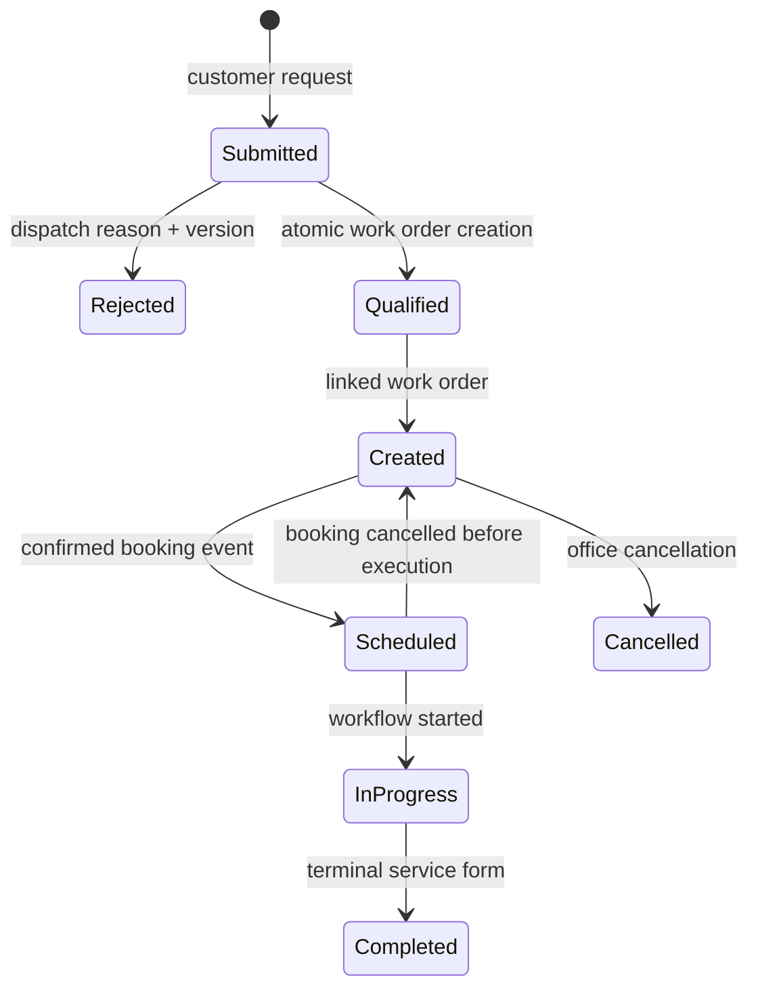
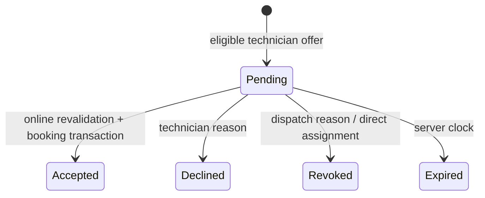

# Business operations and implementation audit

This document describes the source checkout after the operational integrity work. It supersedes the older release archive's statements that customer sign-in and assignment offers do not exist. The ZIP archive is a separate, older snapshot and has not been repackaged.

## Architecture inventory

The actual application uses .NET 10/EF Core/PostgreSQL, React/Vite, Expo/React Native, Keycloak PKCE, RabbitMQ/MassTransit, a Python OR-Tools optimizer, and a separate reporting warehouse. No additional service or framework was introduced.

| Component | Observed implementation and ownership | Remaining boundary |
|---|---|---|
| customers | Customer organizations, contacts, consent, service locations, immutable version history; scoped customer account view | No self-registration or customer-admin membership UI |
| assets | Equipment identity, manufacturer/model/serial, warranty date, hierarchy and location history | Warranty date is not a financial entitlement decision |
| work-orders | Canonical orders and assignment projection; now owns service requests and atomic qualification | No inventory, contract, approval, invoice, or return-visit aggregate |
| technicians | Skills, certification labels, local working hours, availability, time off | No shift attendance, expiring credentials, rest/overtime or territory policy |
| scheduling | Confirmed bookings, overlap/exclusive constraints, recommendations; now exclusive offers and durable assignment revisions | Pending offers do not reserve capacity; no road/traffic routing |
| workflows | Pinned eight-stage templates, optimistic versions, SLA state, durable idempotency receipts, interventions; now v2 evidence/guards and service reports | No file store, verified signatures, estimates, or inventory transactions |
| notifications | Event-ID-deduplicated retained inbox, acknowledgment, best-effort SignalR; offers and booking changes now included | No external push/SMS/email provider, preference engine, or delivery receipts |
| reporting | Append-only events, delivery evidence, read-only replay, operational projections, warehouse queries | Eventual consistency, no financial reporting |
| optimizer | Existing deterministic CP-SAT and baseline, independent result validation | Depot straight-line travel approximation, no parts or territory model |
| web | Role-scoped operations; now dedicated customer portal, intake review queue, pending offers and completed reports | Admin configuration remains limited; no advanced-operation screens |
| technician mobile | Cached jobs, versioned forms, durable queue; now offers, destination handoff, itinerary and stored service activity | OS-specific navigation provider behavior varies; iOS unverified |
| local infrastructure | Compose migration jobs and separate runtime identities, monitoring, gateway, local synthetic users | Development HTTP, local secrets, single-host deployment; no production certification |

Source migrations under `services/` and `analytics/` are authoritative. `data/schema/` holds reference copies, not an independent migration system. Existing deleted/modified release documentation and other user changes were preserved. The optimizer replaces the previously removed intelligence package; that removed package was not restored.

## Entity rules, access, and retention

| Aggregate | Relationships and validation | Authorized access and lifecycle | Retention |
|---|---|---|---|
| Customer | Team-owned organization; nested contacts and locations; one primary contact; consent timestamps | Office manages; customer reads only signed `customer_id` + `team_id`; technicians use assigned-job context | Archive instead of breaking historical references; consent/history retained |
| Asset | Customer/location logical references validated through owner APIs; unique team serial/QR; hierarchy checks | Office manages; customer reads own; technicians read authorized job context | Retain location/change history; archive/decommission |
| ServiceRequest | Exact active customer/location and optional active equipment; title 3–160, problem 10–4000 chars; typed service/urgency | Customer submits; team dispatch reviews; terminal qualification/rejection; version required | No delete endpoint; retained decision and submitter |
| WorkOrder | Snapshots plus opaque customer/location/equipment references; canonical state and expected versions | Team office manages; assigned technician executes; customer gets a safe view of own organization | No deletion; events and report evidence retained |
| Booking | One confirmed booking/order; exclusion constraint prevents technician interval overlap | Team dispatch creates/moves/cancels; assigned execution claims service start | Cancelled records retained; active service cannot be rescheduled or cancelled |
| AssignmentOffer | Scheduling-owned snapshot; one pending offer/order; future appointment, duration ≤8h; expiration within 24h and no later than start | Exact offered technician accepts/declines; team office creates/revokes; expiry worker closes old offers | Terminal records retained with reason/timestamps and optional booking |
| Workflow | One/order; pinned immutable template; ordered stages; expected version and operation ID | Assigned technician/authorized supervisors; customer only reads completed report after exact order ownership proof | Submitted stage answers immutable through APIs; intervention evidence retained |
| Notification | Unique event ID; audience/team/technician scope; acknowledgment pair | Operational inbox only; no customer access to staff alerts | Persisted history; SignalR is an optional transport |
| Audit/outbox/inbox | Transactional event publication, stable event ID, retry metadata, consumer deduplication | Service runtime permissions; privileged read-only replay | Audit evidence append-only; automated age-based purge is not implemented |

Retention durations and legal holds need a company policy before production deployment. There is no claim that an automatic purge or regulatory retention schedule is implemented. Customer membership is provisioned by an administrator in signed Keycloak claims; client input and identity headers cannot grant membership. The initial portal supports one organization per identity. Team scope is operational isolation, not a complete multi-tenant provisioning system.

## Canonical lifecycle

The existing five-state work-order envelope is retained. Offer, travel, SLA, customer acknowledgment, and execution stage are separate facts; they are not competing work-order status strings.

Request qualification does not commit an appointment. A pending offer is an invitation, not a reservation. Declining or expiring never creates a booking or duplicate order. Direct assignment revokes a pending offer in the booking transaction. Acceptance revalidates current qualifications, hours, time off, order state and capacity. An unavailable slot returns a conflict and leaves the technician's form available for review.

| Transition | Prerequisites and effect | Recovery |
|---|---|---|
| Submit request | Signed customer membership; owner API validates active location/equipment; request, receipt and outbox commit together | Retry original operation ID; different payload with same ID returns 409 |
| Qualify | Dispatch policy/team/version; customer/equipment revalidated; reason retained; order + request + events commit together | Concurrent reviewer receives 409 and refreshes; no second order |
| Offer/accept | Dispatch offers only eligible future appointment; exact technician accepts online before expiry | Stable actor-scoped receipt; booking unique/exclusion constraints and order lock; refresh on 409 |
| Move/cancel | Reason, expected booking version, no existing workflow or durable service-start claim | Audit retains prior commitment; completed/active execution is not handed off automatically |
| Begin service | Scheduling-owned durable claim commits under the same order lock as cancel/move | Retry workflow start after a workflow database/network failure; claim is idempotent |
| Cancel work order | Unstarted/unbooked order and expected version; scheduling commits cancellation intent under the allocation lock before order cancellation | Retry cancellation if the order write fails; retained intent prevents a concurrent new assignment |
| Submit stage | Expected workflow version; valid visible fields; v2 progression prerequisites | Receipt replays exact result; offline conflict is retained for explicit review |
| Pause/resume/override | Supervisor permission + reason; one-stage override only; final form still mandatory | Prior breach evidence retained; pause time excluded from stage deadline |
| Complete | Prior stages completed or explicitly overridden; coherent outcome/equipment/follow-up, stored evidence | Workflow and completion events commit together; owner/report/warehouse converge asynchronously |

Scheduling emits a durable, increasing per-order revision for booking creation, cancellation and rescheduling. Work-order projection ignores older revisions, including late cancellation after reassignment and late creation after cancellation. Rescheduling can establish the current assignment if its creation event arrives later. No confirmed appointment is silently changed by recommendations.

## Service execution version 2

The work packet retains the customer's detailed reported problem when a request is qualified. Earlier qualified requests are backfilled by a forward migration. Technicians and office staff can read this authorized detail during preparation/execution; free text is excluded from the general work-order integration payload.

New workflows use template v2; existing v1 instances retain their published configuration and behavior. The eight stage names stay stable for reporting. The form contract now supports bounded text and invariant-decimal number fields as well as choices and conditional fields.

1. **Job accepted:** acceptance and readiness required. Missing equipment requires assistance rather than advancing.
2. **Travel/arrival:** arrival and accessible site required before inspection. A departure or delay cannot complete arrival.
3. **Inspection:** equipment condition, visible damage and safety observations.
4. **Diagnosis:** categorized findings, severity, root cause, parts requirement and diagnostic notes/measurements.
5. **Repair/service:** action, parts readiness, result, work performed and 1–480 labor minutes. Available parts require part-number/quantity documentation. Ordered parts block progression; use assistance and supervisor pause/exception.
6. **Quality:** functional and safety tests must pass and equipment must be operational, or a supervisor must retain an explicit stage exception.
7. **Customer confirmation:** customer informed and service accepted required, or a retained supervisor exception. This is technician-recorded acknowledgment, not a verified customer e-signature or estimate authorization.
8. **Completion:** resolved implies operational equipment; unresolved/limited equipment requires follow-up. The service summary/recommendations are required. The completed report reads the stored answers and pinned labels.

Parts text documents service evidence. It does **not** decrement inventory, reserve stock, calculate costs, or confirm warehouse fulfillment. Labor minutes document service activity; they are not payroll, billable hours or earnings. A completed workflow with an escalated outcome can still require a return visit; automatic return-visit orders and supervisor closeout are backlog items.

The existing SLA is a stage-execution policy: normal warning/critical/breach at 20/25/30 minutes, with supervisor-approved paused time removed and previous breaches retained. It is not an emergency-response or contract SLA. Request acknowledgment, arrival deadlines, holiday calendars, differentiated service policies and business-hours SLA clocks remain unimplemented.

## APIs and events

| Path | Owner / permission |
|---|---|
| `GET /api/customer-portal/account` | customers / Customer, exact signed membership |
| `GET /api/customer-portal/equipment` | assets / Customer, own equipment |
| `GET /api/customer-portal/work-orders[/{id}]` | work-orders / Customer, safe exact-organization view |
| `GET /api/customer-portal/appointments` | scheduling / Customer, bookings of owner-authorized orders; no technician identity |
| `GET /api/service-requests[/{id}]` | work-orders / Customer own organization or team dispatch |
| `POST /api/service-requests` | Customer; body operation ID required |
| `POST /api/service-requests/{id}/qualify` | Dispatcher, Supervisor, OperationsManager, Administrator; version/decision/reason/category/priority |
| `GET,POST /api/assignment-offers` | scheduling / scoped operational read, dispatch write |
| `POST /api/assignment-offers/{id}/accept,decline,revoke` | Exact technician for accept/decline; dispatch revoke; version + operation ID |
| `GET /api/bookings/{id}` | scheduling / scoped operational read |
| `POST /api/bookings/{id}/begin-service` | scheduling / assigned execution; idempotent durable claim |
| `POST /api/scheduling/work-orders/{id}/cancel-intent` | scheduling / dispatch; deny new assignments before work-order cancellation |
| `GET /api/workflows/service-report/{workOrderId}` | workflows / scoped operational or exact-own customer; completed only |

REST uses the existing JSON/problem-details contracts, signed bearer token, no-store responses and correlation IDs. Validation errors return 400, hidden/foreign resources 404, forbidden roles 403, concurrent/stale/ineligible actions 409. Integration events omit customer addresses, names and free-text diagnostic content where possible; detailed workflow form evidence remains privileged in replay. Customer report access is separately authorized and does not grant replay access.

New event families: `ServiceRequestSubmitted/Qualified/Rejected.v1`, `AssignmentOfferCreated/Accepted/Declined/Revoked/Expired.v1`, and `BookingServiceStarted.v1`. Existing booking/workflow events continue driving assignment, notifications and reporting. Notifications store actual offer/booking events; no external delivery or customer message receipt is invented. Offer events remain replay/ingestion evidence and do not establish warehouse assignment facts.

Portal and operational lists are bounded (500 orders/requests/equipment; 1,000 offers). These are local demonstration limits, not complete large-account pagination. Reports are generated from operational workflow records without an external document service.

## Prioritized remaining work

| Priority | Capability | Required next complete slice |
|---|---|---|
| P1 | Inventory | Catalog/stock locations, atomic reservations/consumption/returns, vehicle transfers, negative-stock constraints, job costing and field UI |
| P1 | Estimate approval | Decimal-safe estimates, immutable scope revision, customer decision/signature, backend work authorization and offline conflict policy |
| P1 | Contracts | Entitlements, active/suspended/expired rules, recurring visit uniqueness and renewal handling; actual coverage during qualification |
| P1 | Shift policies | Scheduled shifts, attendance, rest/overtime/on-call/territory and certification-expiry enforcement |
| P1 | Return visits/closeout | Parts blockers, linked follow-up bookings, supervisor quality review and financial closeout distinct from technician completion |
| P2 | Billing | Decimal monetary lines/rates/tax/discount/coverage, internal invoice lifecycle, profitability and approved accounting adapter |
| P2 | SLA | Separate request/assignment/arrival/completion policies, holiday/business calendars, territory/contract rules and DST tests |
| P2 | Media/security | Authorized file upload/download, offline photo queue, malware scanning, signature verification, retention/legal holds |
| P2 | Routing | Coordinate/geocoding consent, supported map, road travel matrix with bounded requests/cache and offline fallback |
| P2 | Notifications | Customer in-app delivery, preference/consent-aware external channels, provider receipts and retry operational tooling |
| P2 | Scale/production | Paged portals, claim-release recovery UI, load/failover/backups, managed secrets/TLS and deployment review |

These capabilities are explicitly **not implemented**; selectable service categories and documentary text do not substitute for them. The executable scenario matrix and exact observed tests are in [Operational verification](OPERATIONS_VERIFICATION.md).

## Dynamics / Dataverse conceptual alignment

This is a proposed mapping for a future adapter, not an implemented integration. No Microsoft subscription is needed locally. Dynamics separates work orders from resource bookings and schedules bookable resources, concepts that correspond to the ownership boundaries retained here. See [Microsoft work orders](https://learn.microsoft.com/en-us/dynamics365/field-service/create-work-order), [bookable resources](https://learn.microsoft.com/en-us/dynamics365/field-service/set-up-bookable-resources), and [Universal Resource Scheduling](https://learn.microsoft.com/en-us/dynamics365/field-service/universal-resource-scheduling-for-field-service).

| FieldOps concept | Conceptual Dynamics/Dataverse counterpart | Adapter constraint |
|---|---|---|
| Customer / contact | Account / contact | Explicit external IDs and organization membership mapping |
| Service location / asset | Service address or functional location / customer asset | Preserve customer/location ownership and equipment history |
| Service request / work order | Case or intake / work order | Idempotent qualification, no automatic promise of booking |
| Technician / skill | Bookable resource / resource characteristic | Map qualifications and calendars explicitly |
| Confirmed booking | Bookable resource booking | Reconcile revision, time window and cancellation safely |
| Stage / checklist | Service task or inspection | Preserve pinned template and immutable submissions |
| Future parts/stock | Product / warehouse/inventory records | Implement FieldOps ownership first; documentary parts text is insufficient |
| Team / future territory | Organizational scope / service territory | Team is not already a geographic territory |

A future authorized adapter should consume the outbox, retain an external-ID/idempotency ledger, use bounded retries/dead letters, and reconcile independent versions instead of writing another service's database. No Dataverse or Power Automate call has been implemented or tested.
