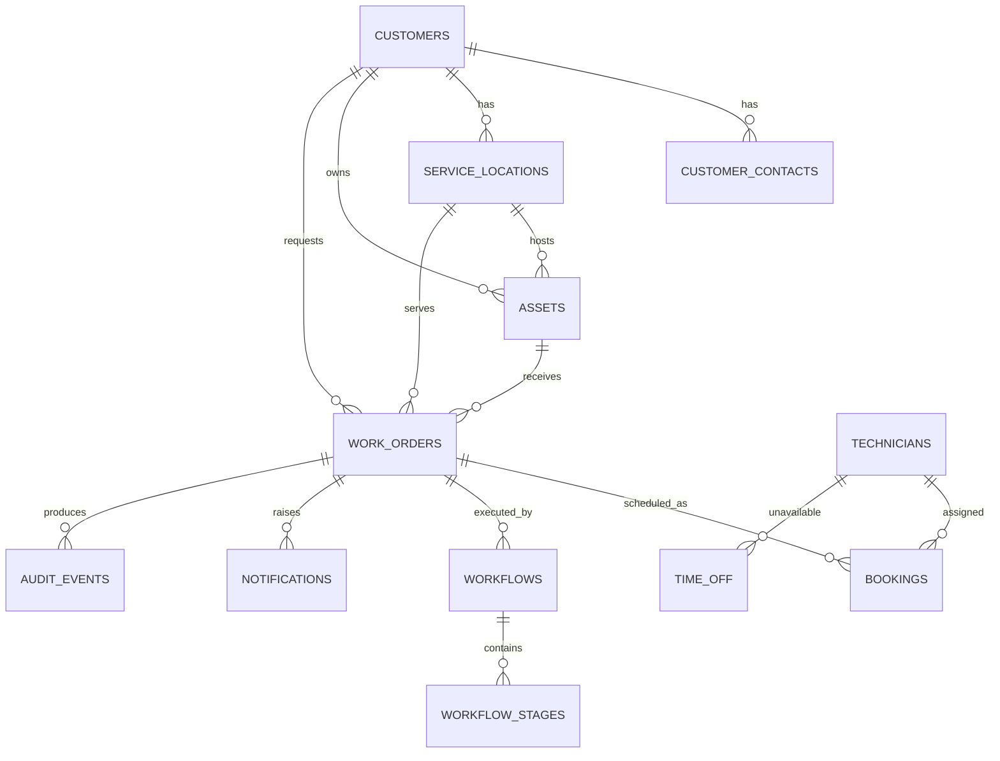

# Database Design

New source migrations add `service_requests`, the order's monotonic `AssignmentRevision` and persisted `ReportedProblem` to work-orders; `assignment_offers`, `assignment_revisions`, `work_order_cancellations` and booking `ServiceStartedAtUtc` to scheduling; and informational notification severity. Ownership, validation and recovery are described in [Business operations](BUSINESS_OPERATIONS.md). Migration history is append-only; `data/schema/` contains reference copies.

## Ownership model

FieldOps 360 uses one PostgreSQL instance for local deployment, but it is not a shared application schema. Each business service owns a separate database and a separate runtime identity:

| Database | Owner | Purpose |
|---|---|---|
| `fieldops_customers` | `customers` | Customer accounts, contacts, service locations, change history. |
| `fieldops_assets` | `assets` | Equipment, hierarchy, warranty, location history, asset changes. |
| `fieldops_work_orders` | `work-orders` | Work-order lifecycle and assignment projection. |
| `fieldops_technicians` | `technicians` | Technician profiles, skills, hours, availability, time off. |
| `fieldops_scheduling` | `scheduling` | Confirmed bookings and scheduling constraints. |
| `fieldops_workflows` | `workflows` | Workflow instances, stage state, answers, SLA evidence. |
| `fieldops_notifications` | `notifications` | Retained alerts and acknowledgment state. |
| `fieldops_reporting` | `reporting` | Audit events, delivery attempts, replay projections. |
| `fieldops_warehouse` | `analytics-worker` | Reporting star schema and analytical views. |
| `keycloak` | Keycloak | Identity realm, clients, roles, and local demo users. |

Schema owners and runtime roles are intentionally different. Migration jobs use the owner connection; service containers use generated least-privilege identities. The database permission verification script checks these boundaries.

## Core operational model

The diagram is logical. Each box is owned by one service; the reporting database stores evidence and projections rather than foreign keys into the operational databases.

### Customers

- `customers`: display name, type, team, status, preferred channel, version, timestamps.
- `customer_contacts`: contact details and explicit email/phone consent.
- `service_locations`: validated site address, access notes, status.
- `customer_changes`: append-only versioned change history.
- Indexes cover team/status/name, contact lookup, location scope, and version uniqueness.

A customer can be archived rather than physically deleted. Work-order creation accepts either a registered customer and location or an explicit `unregisteredCustomerReason`.

### Assets

- `assets`: identity, type, manufacturer/model/serial/QR, criticality, customer/location, parent asset, warranty, status, version.
- `asset_location_history`: effective-dated location changes.
- `asset_changes`: versioned audit history.
- Unique serial numbers and QR codes are scoped by team. Indexes support customer/status/name, type/status, parent hierarchy, and history reads.

### Work orders

- `work_orders`: number, title, customer/site snapshot, optional customer/location/asset references, service category, priority, status, team, technician projection, timestamps, version.
- `idempotency_receipts`: replay-safe create/update requests.
- `outbox_messages` / `inbox_messages`: transactional event delivery.
- Indexes support team recency, technician recency, customer history, and asset history.

Assignment is projected from scheduling events. A dispatcher does not edit a free-text technician field.

### Scheduling

- `bookings`: work order, technician, team, interval, status, version, override reason.
- `one_confirmed_booking_per_order`: a partial unique index on `WorkOrderId` where `Status = 'Confirmed'`.
- `bookings_team_start`: supports the operational board.
- Common outbox/inbox/receipt tables support retries and idempotency.

The booking API revalidates qualifications, working hours, time off, and overlaps inside the transaction. The unique index is the final protection against concurrent duplicate assignments.

### Workflows

- `workflows`: work order, technician, team, template version, current stage index, status, version, started/completed timestamps, stage JSON.
- `workflow_stages` are serialized within the workflow aggregate and carry status, deadline, pause state, SLA state, and answers.
- `idempotency_receipts` makes retried stage submissions safe.
- Version checks reject stale updates.

### Notifications

- `notifications`: event ID (unique), team, technician, work order, type, severity, title, message, acknowledgment, timestamps.
- A deduplication index prevents duplicate retained alerts for the same event.
- Team/technician recency indexes support the inbox and SignalR consumers.

### Reporting evidence

- `audit_events`: immutable event body, event metadata, correlation/trace IDs, integrity hash, receipt/processing timestamps.
- `delivery_attempts`: consumer, attempt, status, error, fault ID, timestamps.
- `replay_projection`: reconstructable state per work order.
- Append-only triggers protect audit evidence from updates and deletes.

## Warehouse model

The warehouse is a star schema in `fieldops_warehouse`:

### Dimensions

- `dim_date`
- `dim_technician` (with type-2 versions and authoritative capacity flags)
- `dim_customer` / `dim_customer_version`
- `dim_service_location`
- `dim_service_category`
- `dim_workflow_stage`
- `dim_work_order_status`
- `dim_supervisor`
- `dim_asset`

### Facts

- `fact_work_order`
- `fact_workflow_stage`
- `fact_booking`
- `fact_sla_breach`
- `fact_supervisor_intervention`
- `fact_customer_change`
- `fact_asset_change`
- `fact_technician_time_off`

### Analytical views

- `analytics.v_stage_duration`: effective stage minutes after valid pause subtraction.
- `analytics.v_team_summary`: team-scoped completion, SLA, booking, and capacity aggregates.
- `analytics.v_customer_registry`: customer counts, location coverage, and linked work orders.
- `analytics.v_asset_registry`: equipment counts, warranty/status coverage, and linked work.

The ingestion ledger and staging table make projection idempotent. `warehouse.schema_migration` records applied warehouse migrations. Late events are allowed to fill missing facts but never clear a completed stage, breach, or terminal state.

## Migration strategy

Operational services use numbered SQL migrations under `services/<service>/migrations/`. The migration runner computes a SHA-256 hash, records it in `fieldops_schema_migrations`, and applies unapplied scripts in order. It takes a PostgreSQL advisory lock, so two migration jobs cannot race.

Warehouse migrations are numbered under `analytics/migrations/` and are applied by the analytics worker's migration command with a separate ledger. The analytical worker uses an owner identity for migration and a writer identity for runtime projection.

The release keeps runtime migrations with their services in `server/` so EF Core and the migration jobs remain buildable. Reference copies and the data dictionary are also included under `data/` for review; the service copies are authoritative.

## Consistency rules

- Every critical business write and its outbox row share one transaction.
- Consumers use stable event IDs in an inbox table; redelivery is a no-op.
- Booking conflicts are resolved in the database, not only in the browser.
- Workflow updates require the expected version.
- SLA deadlines are calculated and stored by the server.
- Replay evidence is append-only; only the Administrator projection rebuild is mutable.
- Warehouse queries use explicit null denominators and never substitute zero for unknown durations.
- Time is stored in UTC. Working-hour conversion uses the technician's IANA time zone.

## Reproducible data

The demonstration data is generated through authenticated APIs, not inserted directly into operational tables. The scripts in `server/scripts/` create labeled synthetic customers, locations, equipment, work orders, bookings, workflows, and completed stages. This exercises the same validation and event paths as a normal user action.

Expected behavior after seeding is documented in [Installation and setup](INSTALLATION_AND_SETUP.md). The release does not include a live database volume or production data.

## Known data limitations

- Contracts, entitlements, installations, and customer accounts are not modeled as first-class entities.
- Historical technician working-hours changes are partially modeled; capacity comparisons should not be treated as payroll data.
- Time-off and weekend exclusions are modeled in the warehouse where the source evidence is available.
- The local deployment uses one PostgreSQL server; it is not a claim of production data isolation at the infrastructure level.
- Jaeger traces are ephemeral and are linked to evidence by trace ID, not copied into the database.
