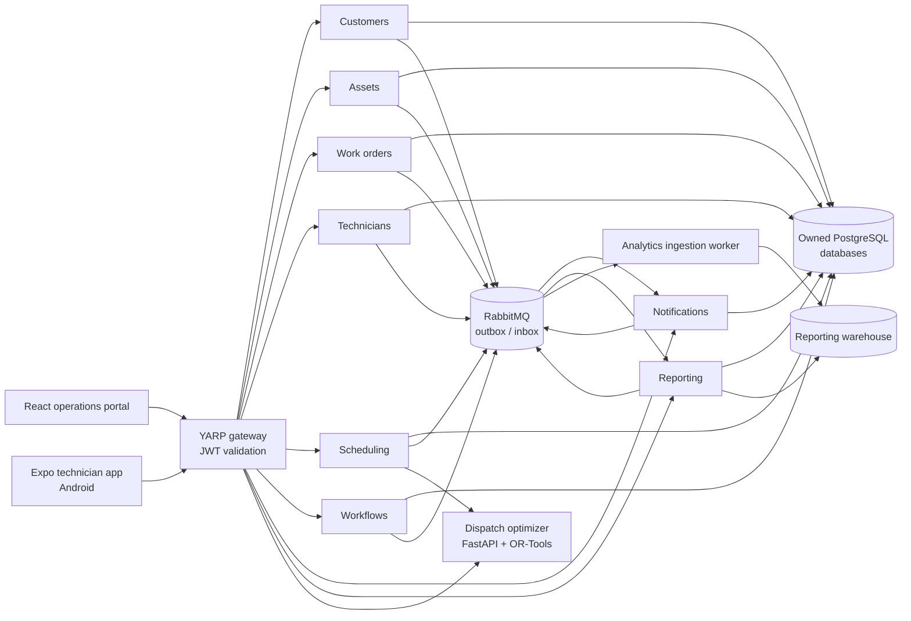

# System Architecture

## Topology

The gateway is the only public backend ingress in the Compose deployment. Each service listens on the private Compose network and validates its own JWT again; the gateway's authentication is not treated as sufficient authorization. The optimizer is deliberately stateless and private.

## Service responsibilities

| Component | Owns | Main behavior |
|---|---|---|
| `customers` | `fieldops_customers` | Customers, contacts, locations, consent, versioned change history. |
| `assets` | `fieldops_assets` | Equipment hierarchy, serial/QR identity, warranty data, location history, asset changes. |
| `work-orders` | `fieldops_work_orders` | Service-request lifecycle, assignment projection, customer/asset references, optimistic versions. |
| `technicians` | `fieldops_technicians` | Skills, certifications, working hours, availability, time off. |
| `scheduling` | `fieldops_scheduling` | Candidate validation, recommendations, confirmed bookings, overlap protection, reschedule/cancel. |
| `workflows` | `fieldops_workflows` | Versioned templates, stage state, answers, SLA milestones, pauses, overrides, assistance. |
| `notifications` | `fieldops_notifications` | Deduplicated inbox records, retained alerts, acknowledgments, SignalR broadcasts. |
| `reporting` | `fieldops_reporting` | Immutable audit evidence, delivery attempts, replay projections, warehouse queries, exports. |
| `analytics-worker` | `fieldops_warehouse` | Event projection into the star schema and backfill/reconciliation. |
| `gateway` | No business data | Authenticated routing, CORS, rate limiting, readiness aggregation, security headers. |
| `optimizer` | No persistent data | Baseline and CP-SAT dispatch evaluation with independent output validation. |

## Request path

1. The browser or mobile app completes a Keycloak Authorization Code + PKCE flow.
2. The app sends a bearer token to the same-origin web proxy, which forwards `/api` and `/hubs` to the gateway.
3. The gateway validates issuer, audience, lifetime, and signing key. It maps signed realm roles to ASP.NET role claims and strips spoofed internal identity headers.
4. YARP forwards the request to the owning service.
5. The service validates the token again and checks the role policy, team scope, and resource ownership.
6. The service writes its own database transaction and, when required, an outbox row in the same transaction.
7. The response is returned with `Cache-Control: no-store` and browser security headers.

## Event path

Business services use a transactional outbox. A background dispatcher publishes pending rows to RabbitMQ. Consumers use an inbox table with a unique stable event ID, so a redelivered event is processed once.

Events carry `EventId`, `EventType`, `EventVersion`, `WorkOrderId`, actor identity and role, source service, correlation ID, optional causation ID, trace/span IDs, occurrence and recording timestamps, sequence number, and a JSON payload. The reporting service stores the original body and an integrity hash; replay never rewrites that evidence.

The notification consumer projects events into retained alerts. The analytics worker projects the same business events into the warehouse. Reporting also writes a replay projection for fast reads. These are separate consumers with separate failure behavior; a delayed warehouse projection does not block the operational write.

## Scheduling design

Scheduling first applies hard rules in the service:

- the technician belongs to the order's team and is available;
- required skills and certifications match;
- the appointment is inside the technician's local working hours;
- approved time off and confirmed bookings do not overlap;
- the appointment fits one UTC service day.

The baseline strategy ranks feasible technicians by a deterministic workload/travel/delay score. The optimized strategy sends the bounded problem to the Python optimizer. OR-Tools CP-SAT uses optional intervals and `NoOverlap` constraints. It minimizes priority-weighted unassigned work, a straight-line depot travel proxy, start delay, and workload spread. The optimizer result is checked independently by the .NET service before it is shown.

A recommendation does not reserve capacity. The dispatcher must confirm a booking. PostgreSQL's partial unique index permits only one confirmed booking per work order, and the booking transaction revalidates availability. Manual overrides still pass through the same audited booking API.

Travel is a straight-line, round-trip depot estimate at 40 km/h. Traffic, road routing, and between-job travel are not modeled. The optimizer is a decision aid; it is not an autonomous dispatcher.

## Workflow and SLA design

The default template has eight ordered stages. The server creates stage instances with explicit deadlines. A background sweep evaluates warning (20 minutes), critical (25 minutes), and breach (30 minutes) thresholds in the normal configuration. The thresholds are configuration values, not hard-coded UI timers.

Pausing records the pause time and accumulates paused seconds. Resuming keeps the earlier breach evidence and recalculates the effective deadline without erasing history. An override advances exactly one stage and requires a reason; final completion still requires the terminal stage form. The accelerated demo configuration uses 20/25/30 seconds so a breach can be demonstrated in a short session.

## Replay and reporting

Operational Replay accepts a work order ID and returns:

- causally ordered business events;
- source sequence and occurrence timestamps;
- causation and correlation identifiers;
- delivery attempts, retry counts, and failures;
- integrity verification for each stored body;
- an explicit ordering-uncertainty flag for independent service events;
- reconstructed workflow/SLA state and an incident summary;
- CSV and PDF exports.

Replay is read-only. The only mutation is an Administrator-only projection rebuild; immutable event rows are retained. The analytics warehouse is a separate star schema and is queried through a read-only reporting identity. Warehouse metrics use explicit denominators and return `null` when a population cannot support a rate.

## Security boundaries

- OIDC discovery and token validation use Keycloak.
- Realm roles are the only source of role claims.
- Every service enforces role policies and resource-level team/technician scope.
- The optimizer and databases have no published host ports.
- Runtime database identities are distinct from schema owners and have least-privilege grants.
- Browser tokens are held by the OIDC client; the UI does not persist them in local storage.
- Mobile tokens use SecureStore.
- Replay exports are privileged and neutralize spreadsheet formula injection in CSV output.

The detailed threat model and operational caveats are in [Security](SECURITY.md).

## Deployment

The release is a single-host Docker Compose deployment for local demonstration:

- PostgreSQL 18, RabbitMQ 4.2, Keycloak 26.8;
- eight .NET business services and the gateway;
- one Python optimizer container;
- one analytics ingestion worker;
- nginx-served React application;
- optional Prometheus, Grafana, and Jaeger profiles.

The Compose stack uses loopback-bound published ports for the web, gateway, Keycloak, RabbitMQ management, PostgreSQL, and monitoring. The archive is arranged as `client/`, `server/`, `data/`, and `docs/`; the `server/docker-compose.yml` file uses `../client` only for the web image build and keeps all other build contexts inside `server/`.

## Tradeoffs

- A single PostgreSQL instance hosts isolated databases for local simplicity. Production would use managed instances, backups, and network policies.
- Reporting is eventually consistent by design. The UI exposes freshness rather than pretending the warehouse is transactional.
- The local stack uses HTTP and generated credentials. Production requires TLS, managed secrets, MFA/device policy, and a deployment-specific review.
- Cross-service workflows are not distributed serializable transactions. The outbox/inbox pattern makes progress observable and retryable instead.
