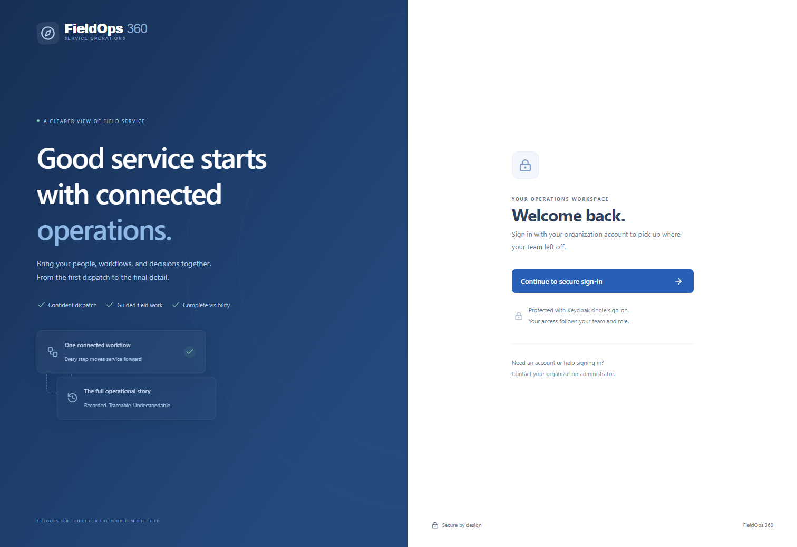

# FieldOps 360 UI walkthrough

Open the local web application at `http://localhost:8088`. Use the generated development accounts and password from the root `.env`; credentials are not reproduced here. The [web README](../apps/web/README.md) contains the complete run commands and browser-session behavior.

The screenshots linked below are actual local application captures with synthetic data, taken on November 4, 2026 around 19:01 America/New_York. All six were refreshed from the running local application and inspected, including the guided workflow and replay. These snapshots do not establish that every master requirement is complete; see [implementation status](IMPLEMENTATION_STATUS.md) for executed tests and remaining work.

## Sign in and find your workspace

Select **Continue to secure sign-in** to open Keycloak. After successful PKCE login, navigation follows the authenticated role. The backend separately enforces role, team, and assigned-technician access. Browser tokens remain in memory; a page refresh returns to the sign-in entry point and can reuse the existing identity-provider session.



The [operations overview](screenshots/operations-overview.png) brings together current service activity, stage SLA status, recent orders, and task shortcuts. The refreshed capture includes actual overdue work from the synthetic scenario. Warehouse-backed counts and operational lists have different refresh paths; use the freshness label and metric definitions when interpreting them.

## Dispatch and execute service

1. As a dispatcher, open **Work orders → Create work order**. Enter the synthetic customer, location, category, title, and priority.
2. Open **Schedule service**, choose an appointment, and request baseline or OR-Tools recommendations. Review the recorded qualifications and workload explanation; real route travel is unavailable and is not invented. Confirm a technician, providing a reason when choosing a lower-ranked recommendation. Booking confirmation rechecks constraints; a conflicting appointment is rejected rather than silently double-booked.
3. As the assigned technician, open **My workflow** and start or continue the job. The eight stages are Job Accepted, Travel / Arrival, Initial Inspection, Diagnosis, Repair / Service, Quality Verification, Customer Confirmation, and Job Completion. Each screen uses the instance's versioned backend form, including conditional fields.
4. Select accurate answers and use **Submit & continue**. **Save draft** preserves selected answers on that device. **Request supervisor assistance** provides a path when none of the supplied answers fits. Completed or overridden stages remain read-only history; terminal completion shows eight of eight stages complete.

The [guided workflow capture](screenshots/guided-service-workflow.png) shows the actual stage screen. The backend owns stage order, concurrency, idempotency, timestamps, and SLA deadlines. The displayed countdown is informational. Browser drafts do not pause the SLA or submit themselves; the separate mobile app owns the durable offline synchronization queue.

## Supervise and review advice

The [supervisor workspace](screenshots/supervisor-dashboard.png) prioritizes stages approaching or exceeding their deadline. The refreshed capture contains an overdue row with its recorded SLA status. Persisted notification and escalation delivery are independently verified by the reliability demonstration; a screenshot alone does not prove message delivery.

Stage warnings occur at the configured 20/25/30-minute thresholds. Authorized supervisors can acknowledge notifications, approve a reasoned pause, resume work, request assistance, or apply an audited override. Advisory risk assessment requires reviewing inputs that are not available directly from the workflow; such inputs are labeled assumptions. Results show the model version, probability, factors, timestamp, synthetic-training limitation, and proposed intervention. Accepting or dismissing advice records a reason; it does not automatically reassign work or evaluate employee performance.

## Analyze and investigate

The [analytics workspace](screenshots/analytics-dashboard.png) displays warehouse-derived volume, completion, SLA, stage-duration, category, and utilization aggregates, with date/category/technician filters, freshness, definitions, and CSV/PDF exports. The short service durations in this capture come from a quickly executed synthetic test lifecycle and are not production performance claims.

The [replay capture](screenshots/operational-replay.png) shows the refreshed investigation view. Open **Operational replay**, choose a work order, and select **Investigate**. Step through evidence with previous/next, play/pause, speed, timestamp, breach, and intervention controls. The historical cursor changes only reconstructed state; it never re-executes workflow commands. Use event, service, actor, time, correlation, and trace filters to narrow the timeline.

Event details distinguish occurrence, receipt, processing, logical business actions, and delivery observations. Unknown attempt totals remain unknown. Causation gaps and uncertain ordering are labeled. **Check trace availability** uses the authenticated work-order-scoped replay endpoint; a public Jaeger trace link appears only after confirmed availability. Expired evidence and an unreachable provider are distinct outcomes. Incident exports contain recorded facts and separately identified inferences.

## Refresh the image evidence

After the complete stack is healthy and the demonstration has populated useful history, run from `apps/web` in the host shell:

```powershell
$env:WEB_BASE_URL = 'http://localhost:8088'
npm run screenshots
```

Inspect the resulting `apps/web/artifacts` images before copying successful captures to `docs/screenshots`. A screenshot is visual evidence of the captured state; [browser tests](../apps/web/e2e/operations.spec.ts), API tests, and the implementation report provide behavioral evidence. Automated layout checks do not establish complete WCAG 2.2 AA compliance; see the [accessibility notes](ui-ux/design-system.md).
