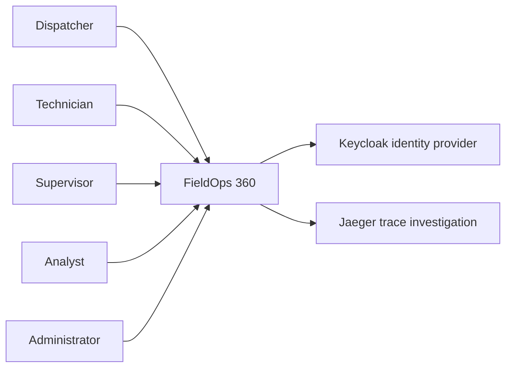
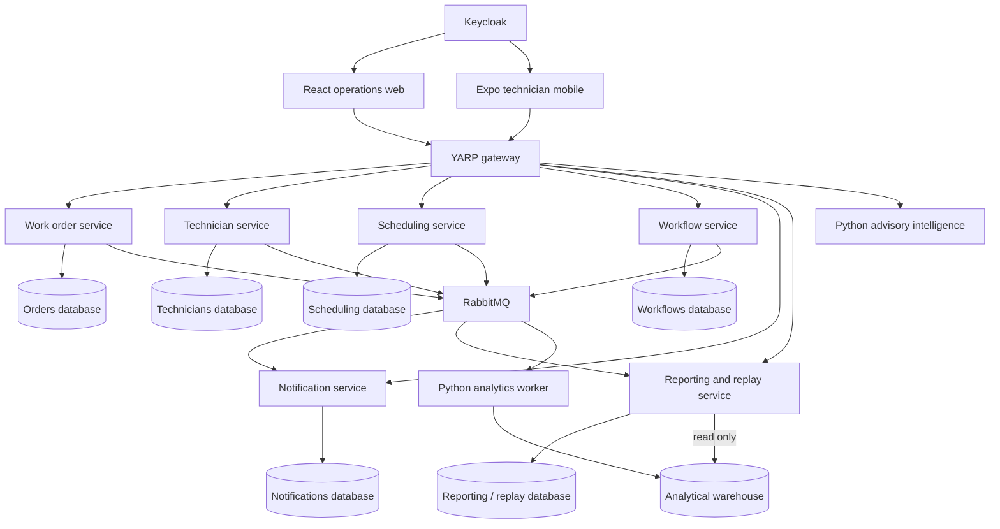
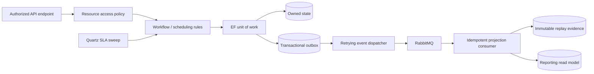

# Architecture and service ownership

FieldOps 360 manages a regional HVAC service workflow. Six deployable ASP.NET Core services own independent PostgreSQL databases; shared libraries contain infrastructure and contracts, not shared operational tables. Deployments select a single service role. Cross-service HTTP checks validate prerequisites; event consumers populate local read models. Critical booking and workflow writes must remain strongly consistent within their owning database.

| Component | Owned state | External route |
|---|---|---|
| Work orders | Orders, customer references, lifecycle, outbox | `/api/work-orders` |
| Technicians | Staff, qualifications, working hours, team ownership | `/api/technicians` |
| Scheduling | Confirmed bookings, dispatch decisions, outbox | `/api/bookings`, `/api/scheduling` |
| Workflows | Versioned forms, stages, SLA clock state, submissions, outbox | `/api/workflows` |
| Notifications | Deduplicated alerts, acknowledgment, delivery history | `/api/notifications`, `/hubs/notifications` |
| Reporting | Replay evidence/projection and analytical read models | `/api/reports`, `/api/replay` |
| Gateway | Validates ingress authentication and proxies to services | Port 5100 |
| Intelligence | Synthetic model artifact and stateless optimization/inference | Gateway authorized routes |
| Keycloak | Users, roles, PKCE/OIDC sessions | Port 8080 |

Reporting hosts the replay processor. A separate Python analytics worker consumes events into an independent warehouse; Reporting has a read-only warehouse connection. Six service migration jobs and a warehouse migration job use owner identities, then exit. Long-running service identities cannot create or alter schemas. Replay event and delivery tables allow runtime SELECT/INSERT only. Integration limitations are recorded in the status document.

## Trust boundaries

Browsers and phones are untrusted. Keycloak issues signed access tokens with audience `fieldops-api`, roles and `team_id`. Every service validates tokens and checks resource access; the gateway is defense in depth. Technicians only see assigned jobs. Supervisors only act within their team. Analysts use masked aggregate reporting. Replay requires explicit supervisor or administrator policy. Machine-to-machine access uses a distinct client credentials identity and audience, never a user-controlled role header.

## Time, concurrency and evidence

The workflow service owns authoritative UTC timestamps. Client occurrence times are labeled and never change SLA calculations. Stage completion requires an expected workflow version and idempotency key. PostgreSQL enforces non-overlapping confirmed bookings. Business state and outbox events commit together. Replay separates immutable logical events from delivery attempts; receipt order never substitutes for business occurrence or causation order.

## System context (C4 level 1)

## Containers (C4 level 2)

## Components (C4 level 3)

Technology support reference: [.NET support policy](https://dotnet.microsoft.com/en-us/platform/support/policy/dotnet-core). The repository targets .NET 10 LTS, not the locally installed preview runtime.
