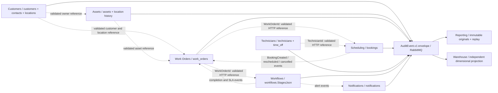
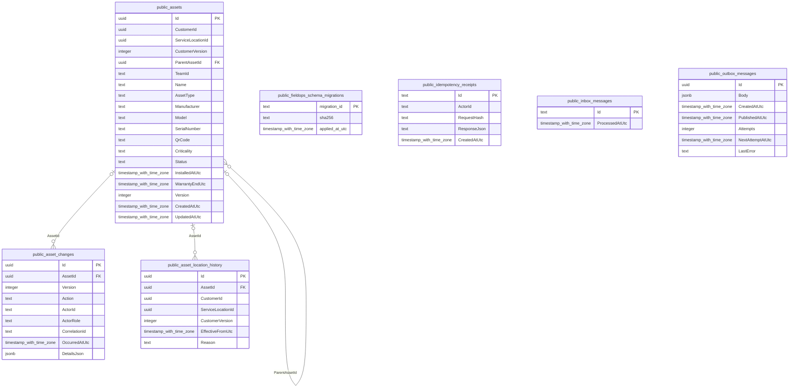
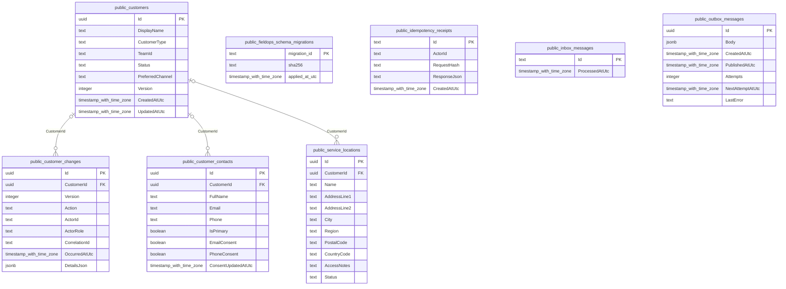
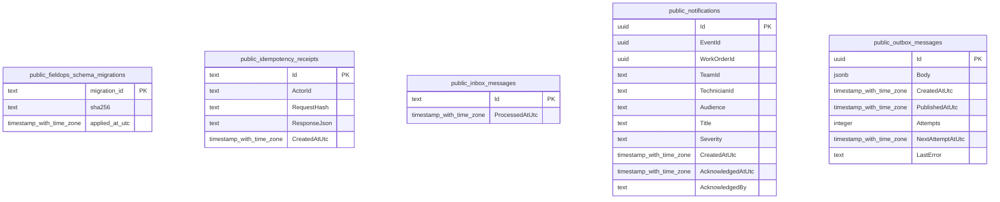
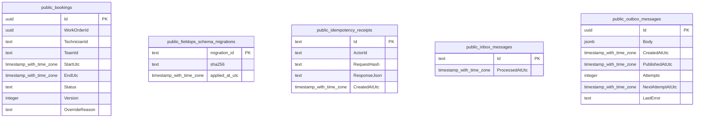
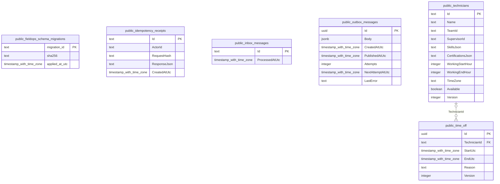
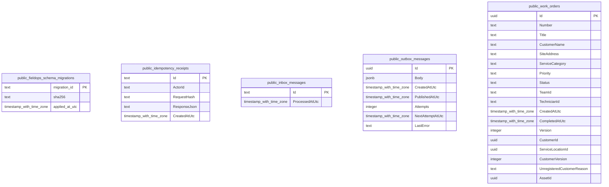
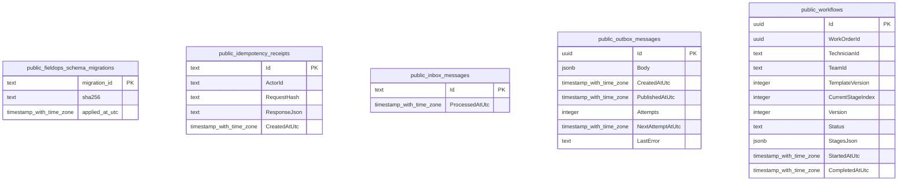

# Entity relationship diagrams from the live schema

Physical baseline captured `2026-11-05T16:34:37.138936+00:00`. Generated by [render-data-catalog.py](../../scripts/render-data-catalog.py) from the [read-only catalog audit](../../scripts/audit-data-catalog.py). Every solid ER relationship below is a captured PostgreSQL foreign key. The cardinality symbol is conservative (optional parent / multiple children); consult nullable and unique rules in the [dictionary](DATA_DICTIONARY.md) for exact optionality. No cross-database relationship is a physical FK.

## Overall implemented logical model

The arrows below are application references or event projections, not SQL constraints. Work orders reference registered customers, service locations and equipment while retaining customer/address snapshots for historical display. Explicit unregistered exceptions preserve legacy requests. A stage named Initial Inspection is part of the workflow JSON aggregate; it does not establish a general inspection module.

## Implemented per-service physical diagrams

Each diagram contains every captured physical table owned by that service, including disconnected support tables. Disconnected tables deliberately have no invented FK to a business aggregate. Mermaid type aliases normalize PostgreSQL punctuation for rendering; the dictionary retains exact SQL types.

### fieldops_assets

7 physical tables. [Standalone Mermaid source](physical/fieldops_assets.mmd).

### fieldops_customers

8 physical tables. [Standalone Mermaid source](physical/fieldops_customers.mmd).

### fieldops_notifications

5 physical tables. [Standalone Mermaid source](physical/fieldops_notifications.mmd).

### fieldops_reporting

9 physical tables. [Standalone Mermaid source](physical/fieldops_reporting.mmd).

```mermaid
erDiagram
  public_audit_events {
    uuid EventId PK
    uuid WorkOrderId
    text EventType
    text SourceService
    text TeamId
    text ActorId
    text Body
    timestamp_with_time_zone OccurredAtUtc
    timestamp_with_time_zone ReceivedAtUtc
    timestamp_with_time_zone ProcessedAtUtc
    bigint SequenceNumber
    text CorrelationId
    text TraceId
    text IntegrityHash
  }
  public_delivery_attempts {
    uuid Id PK
    uuid EventId
    integer Attempt
    timestamp_with_time_zone ReceivedAtUtc
    timestamp_with_time_zone ProcessedAtUtc
    text Status
    text Error
    text ConsumerService
    uuid FaultId
    timestamp_with_time_zone OccurredAtUtc
  }
  public_fact_work_order {
    uuid WorkOrderId PK
    text Number
    text TeamId
    text ServiceCategory
    text Priority
    text TechnicianId
    timestamp_with_time_zone CreatedAtUtc
    timestamp_with_time_zone CompletedAtUtc
    text Status
    timestamp_with_time_zone UpdatedAtUtc
  }
  public_fact_workflow_stage {
    uuid StageInstanceId PK
    uuid WorkOrderId
    text TeamId
    text Stage
    text TechnicianId
    timestamp_with_time_zone StartedAtUtc
    timestamp_with_time_zone CompletedAtUtc
    timestamp_with_time_zone DeadlineUtc
    boolean Breached
    double_precision PausedSeconds
    text SlaStatus
    timestamp_with_time_zone UpdatedAtUtc
  }
  public_fieldops_schema_migrations {
    text migration_id PK
    text sha256
    timestamp_with_time_zone applied_at_utc
  }
  public_idempotency_receipts {
    text Id PK
    text ActorId
    text RequestHash
    text ResponseJson
    timestamp_with_time_zone CreatedAtUtc
  }
  public_inbox_messages {
    text Id PK
    timestamp_with_time_zone ProcessedAtUtc
  }
  public_outbox_messages {
    uuid Id PK
    jsonb Body
    timestamp_with_time_zone CreatedAtUtc
    timestamp_with_time_zone PublishedAtUtc
    integer Attempts
    timestamp_with_time_zone NextAttemptAtUtc
    text LastError
  }
  public_replay_projection {
    uuid WorkOrderId PK
    text TeamId
    jsonb StateJson
    integer EventCount
    timestamp_with_time_zone UpdatedAtUtc
  }
```

### fieldops_scheduling

5 physical tables. [Standalone Mermaid source](physical/fieldops_scheduling.mmd).

### fieldops_technicians

6 physical tables. [Standalone Mermaid source](physical/fieldops_technicians.mmd).

### fieldops_warehouse

21 physical tables. [Standalone Mermaid source](physical/fieldops_warehouse.mmd).

```mermaid
erDiagram
  warehouse_dim_asset {
    bigint asset_key PK
    uuid asset_reference
    bigint customer_key FK
    text team_id
    text asset_type
    text criticality
    text status
    text manufacturer
    text model
    uuid parent_asset_reference
    integer source_version
    timestamp_with_time_zone installed_at_utc
    timestamp_with_time_zone warranty_end_utc
    timestamp_with_time_zone created_at_utc
    timestamp_with_time_zone updated_at_utc
    timestamp_with_time_zone last_ingested_at_utc
  }
  warehouse_dim_customer {
    bigint customer_key PK
    text customer_reference
    text team_id
    integer source_version
    text customer_type
    text status
    text preferred_channel
    integer contact_count
    integer location_count
    integer active_location_count
    integer email_consent_count
    integer phone_consent_count
    timestamp_with_time_zone created_at_utc
    timestamp_with_time_zone updated_at_utc
    timestamp_with_time_zone last_ingested_at_utc
  }
  warehouse_dim_customer_version {
    bigint customer_version_key PK
    bigint customer_key FK
    integer source_version
    text team_id
    text customer_type
    text status
    text preferred_channel
    integer contact_count
    integer location_count
    integer active_location_count
    integer email_consent_count
    integer phone_consent_count
    timestamp_with_time_zone occurred_at_utc
    boolean inferred
    text snapshot_hash
  }
  warehouse_dim_date {
    integer date_key PK
    date calendar_date
    integer calendar_year
    integer calendar_month
    integer day_of_week
  }
  warehouse_dim_service_category {
    bigint category_key PK
    text category
  }
  warehouse_dim_service_location {
    bigint service_location_key PK
    uuid service_location_id
    bigint customer_key FK
    text team_id
    text status
    integer source_version
  }
  warehouse_dim_supervisor {
    bigint supervisor_key PK
    text supervisor_id
    text team_id
  }
  warehouse_dim_technician {
    bigint technician_key PK
    text technician_id
    text team_id
    integer working_minutes_per_day
    boolean capacity_authoritative
    bigint source_sequence
    integer working_start_hour
    integer working_end_hour
    text time_zone
    timestamp_with_time_zone effective_from_utc
    timestamp_with_time_zone effective_to_utc
    boolean is_current
    text supervisor_id
    jsonb skills
    jsonb certifications
    boolean available
    text row_hash
  }
  warehouse_dim_work_order_status {
    bigint status_key PK
    text status
  }
  warehouse_dim_workflow_stage {
    bigint stage_key PK
    integer stage_index
    text stage_name
  }
  warehouse_fact_asset_change {
    uuid event_id PK,FK
    bigint asset_key FK
    integer source_version
    text event_type
    timestamp_with_time_zone occurred_at_utc
  }
  warehouse_fact_booking {
    uuid booking_id PK
    uuid work_order_id FK
    bigint technician_key FK
    timestamp_with_time_zone start_utc
    timestamp_with_time_zone end_utc
    text status
    bigint source_version
  }
  warehouse_fact_customer_change {
    uuid event_id PK,FK
    bigint customer_key FK
    bigint customer_version_key FK
    integer source_version
    text event_type
    timestamp_with_time_zone occurred_at_utc
  }
  warehouse_fact_sla_breach {
    uuid event_id PK,FK
    uuid work_order_id FK
    uuid stage_instance_id FK
    timestamp_with_time_zone occurred_at_utc
  }
  warehouse_fact_supervisor_intervention {
    uuid event_id PK,FK
    uuid work_order_id FK
    bigint supervisor_key FK
    text intervention_type
    timestamp_with_time_zone occurred_at_utc
  }
  warehouse_fact_technician_time_off {
    uuid event_id PK,FK
    uuid time_off_id
    bigint technician_key FK
    text technician_id
    text team_id
    timestamp_with_time_zone start_utc
    timestamp_with_time_zone end_utc
    bigint source_sequence
    timestamp_with_time_zone recorded_at_utc
  }
  warehouse_fact_work_order {
    uuid work_order_id PK
    text number
    text team_id
    bigint technician_key FK
    bigint customer_key FK
    bigint category_key FK
    bigint status_key FK
    integer created_date_key FK
    text priority
    timestamp_with_time_zone created_at_utc
    timestamp_with_time_zone completed_at_utc
    timestamp_with_time_zone last_occurrence_utc
    timestamp_with_time_zone last_ingested_at_utc
    bigint order_source_sequence
    timestamp_with_time_zone order_source_occurred_at_utc
    text source_status
    timestamp_with_time_zone workflow_started_at_utc
    bigint customer_version_key FK
    bigint service_location_key FK
    uuid asset_reference
  }
  warehouse_fact_workflow_stage {
    uuid stage_instance_id PK
    uuid work_order_id FK
    bigint stage_key FK
    timestamp_with_time_zone started_at_utc
    timestamp_with_time_zone deadline_utc
    timestamp_with_time_zone completed_at_utc
    double_precision paused_seconds
    boolean breached
    text status
    bigint last_sequence
    text sla_status
  }
  warehouse_ingestion_ledger {
    uuid event_id PK
    text event_type
    text source_service
    timestamp_with_time_zone occurred_at_utc
    timestamp_with_time_zone ingested_at_utc
    text payload_hash
    integer schema_version
    bigint source_sequence
  }
  warehouse_schema_migration {
    text version PK
    timestamp_with_time_zone applied_at_utc
  }
  warehouse_staging_event {
    uuid event_id PK,FK
    uuid work_order_id
    jsonb safe_payload
  }
  warehouse_dim_customer |o--o{ warehouse_dim_asset : "customer_key"
  warehouse_dim_customer |o--o{ warehouse_dim_customer_version : "customer_key"
  warehouse_dim_customer |o--o{ warehouse_dim_service_location : "customer_key"
  warehouse_dim_asset |o--o{ warehouse_fact_asset_change : "asset_key"
  warehouse_ingestion_ledger |o--o{ warehouse_fact_asset_change : "event_id"
  warehouse_dim_technician |o--o{ warehouse_fact_booking : "technician_key"
  warehouse_fact_work_order |o--o{ warehouse_fact_booking : "work_order_id"
  warehouse_dim_customer |o--o{ warehouse_fact_customer_change : "customer_key"
  warehouse_dim_customer_version |o--o{ warehouse_fact_customer_change : "customer_version_key,customer_key"
  warehouse_ingestion_ledger |o--o{ warehouse_fact_customer_change : "event_id"
  warehouse_ingestion_ledger |o--o{ warehouse_fact_sla_breach : "event_id"
  warehouse_fact_workflow_stage |o--o{ warehouse_fact_sla_breach : "stage_instance_id"
  warehouse_fact_work_order |o--o{ warehouse_fact_sla_breach : "work_order_id"
  warehouse_ingestion_ledger |o--o{ warehouse_fact_supervisor_intervention : "event_id"
  warehouse_dim_supervisor |o--o{ warehouse_fact_supervisor_intervention : "supervisor_key"
  warehouse_fact_work_order |o--o{ warehouse_fact_supervisor_intervention : "work_order_id"
  warehouse_ingestion_ledger |o--o{ warehouse_fact_technician_time_off : "event_id"
  warehouse_dim_technician |o--o{ warehouse_fact_technician_time_off : "technician_key"
  warehouse_dim_service_category |o--o{ warehouse_fact_work_order : "category_key"
  warehouse_dim_date |o--o{ warehouse_fact_work_order : "created_date_key"
  warehouse_dim_customer |o--o{ warehouse_fact_work_order : "customer_key"
  warehouse_dim_work_order_status |o--o{ warehouse_fact_work_order : "status_key"
  warehouse_dim_technician |o--o{ warehouse_fact_work_order : "technician_key"
  warehouse_dim_service_location |o--o{ warehouse_fact_work_order : "service_location_key,customer_key"
  warehouse_dim_customer_version |o--o{ warehouse_fact_work_order : "customer_version_key,customer_key"
  warehouse_dim_workflow_stage |o--o{ warehouse_fact_workflow_stage : "stage_key"
  warehouse_fact_work_order |o--o{ warehouse_fact_workflow_stage : "work_order_id"
  warehouse_ingestion_ledger |o--o{ warehouse_staging_event : "event_id"
```

### fieldops_work_orders

5 physical tables. [Standalone Mermaid source](physical/fieldops_work_orders.mmd).

### fieldops_workflows

5 physical tables. [Standalone Mermaid source](physical/fieldops_workflows.mmd).

## Requested models that are not implemented in this baseline

| Requested diagram | Implemented boundary | Why no physical diagram is drawn |
|---|---|---|
| Customer to asset | Customer/contact/location and asset/hierarchy/location-history registries are captured above | Cross-service customer, location and work-order links are validated API references; physical FKs remain within each owning database. |
| Inspection | Version-pinned eight-stage workflow JSON | No independent inspection templates/sections/questions/measurements/evidence/signatures model. |
| Inventory transaction | None | No products, warehouses, stock ledger, reservation, purchase or consumption tables. |
| Agreement and preventive maintenance | None | No agreements, recurrence, occurrences, renewal or compliance tables. |
| Billing | None | No estimates, rates, invoices, taxes, payments or currency ledger. Reporting PDF export is not invoicing. |
| IoT telemetry and alerts | Operational SLA notifications only | No device, telemetry, alert-rule or equipment-alert tables. |

These are unimplemented required domains, not empty existing schemas. Customer→Location→Asset→WorkOrder references are implemented across their owning services; the remaining domains need implementation and migrations before physical diagrams can be added. The [granular completion matrix](../engineering/FULL_STACK_FEATURE_COMPLETION_MATRIX.md) tracks each missing capability. The warehouse physical diagram above is the actual star schema, including its ledger/staging links; it must not be substituted with proposed candidate facts.
