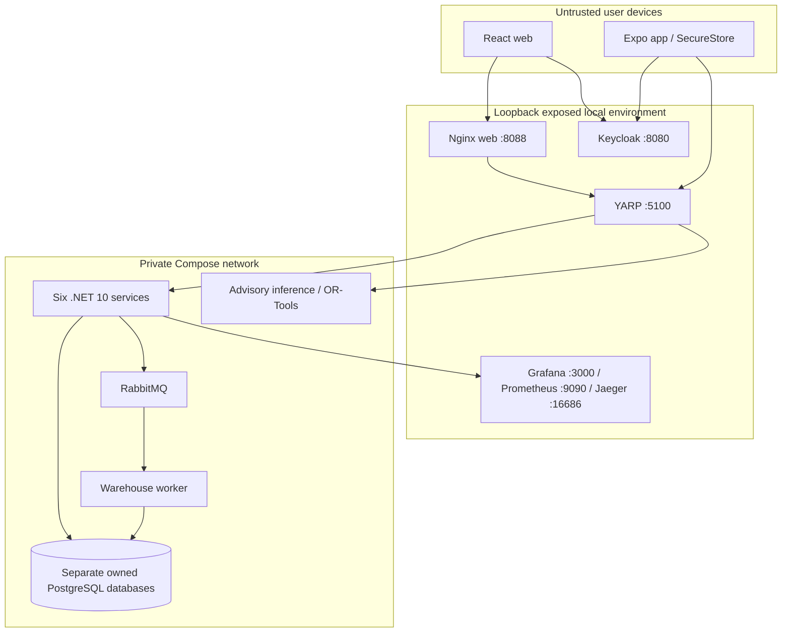
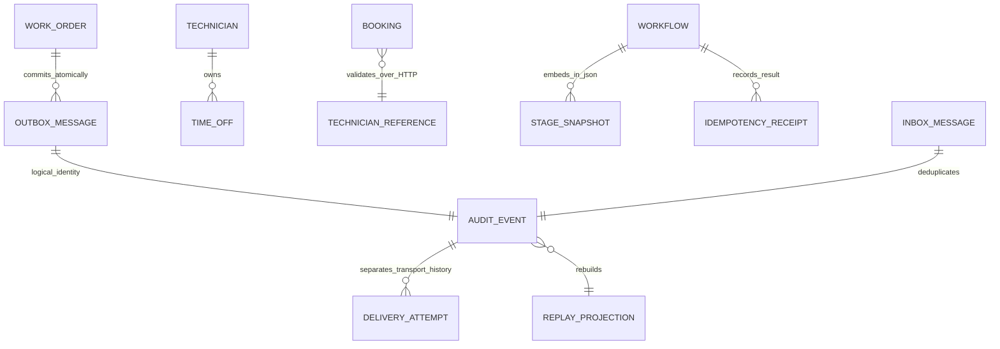
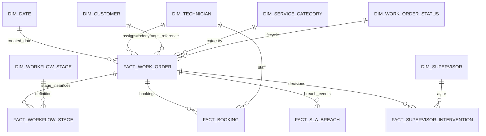
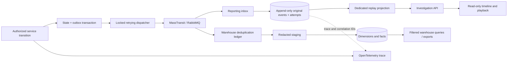
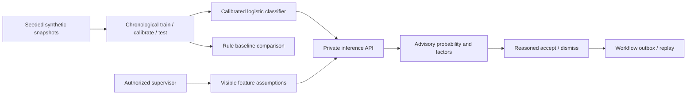
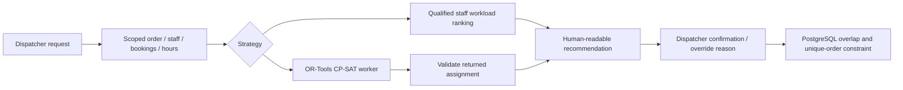

# Deployment, data and trust diagrams

The ERD shows logical references across service boundaries, not cross-database foreign keys. Work orders, technicians, scheduling, workflows, notifications and reporting each own separate stores. Service migrations under each service folder are the authoritative physical schemas. Workflows store stage snapshots in one versioned aggregate to make concurrent transition checks atomic.

