# Implemented interaction sequences

These sequences describe local implementation paths. Cross-service projections are eventual; a response from a source service does not promise every read model has caught up.

## 1. User login
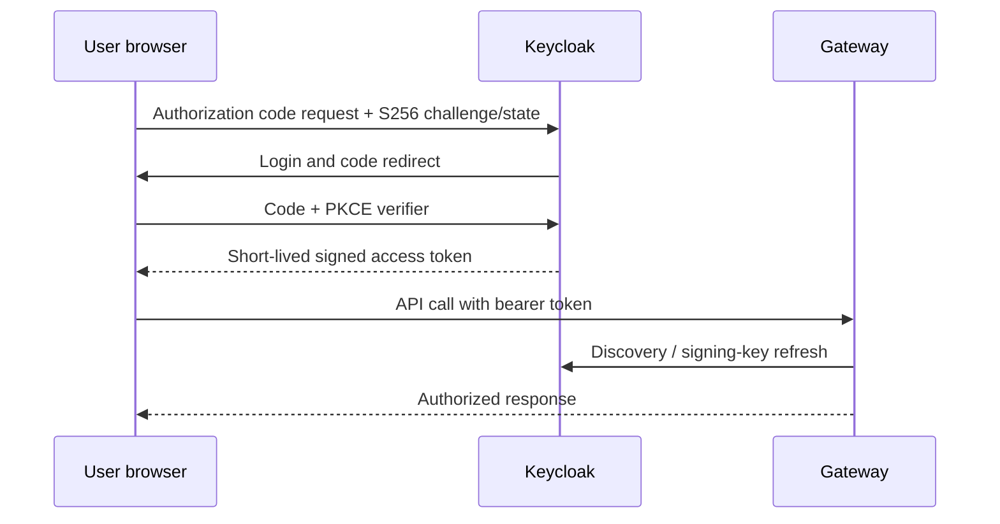

## 2. Work order creation
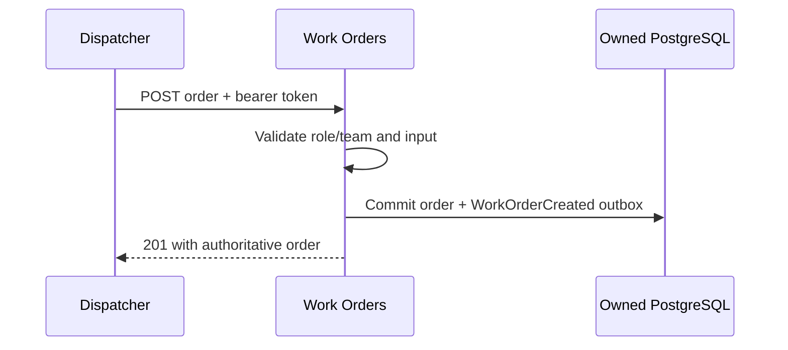

## 3. Technician scheduling
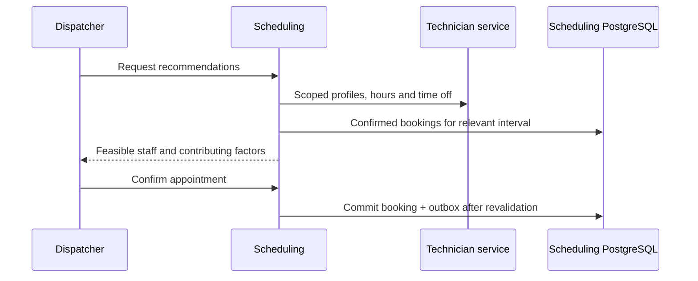

## 4. Booking conflict prevention
```mermaid
sequenceDiagram
  participant A as Dispatcher A
  participant B as Dispatcher B
  participant S as Scheduling
  participant P as PostgreSQL
  A->>S: Create confirmed interval
  B->>S: Concurrent overlapping interval
  S->>P: INSERT A
  S->>P: INSERT B
  P-->>S: One commit; one exclusion violation
  S-->>A: 201
  S-->>B: 409 conflict
```

## 5. Workflow initiation
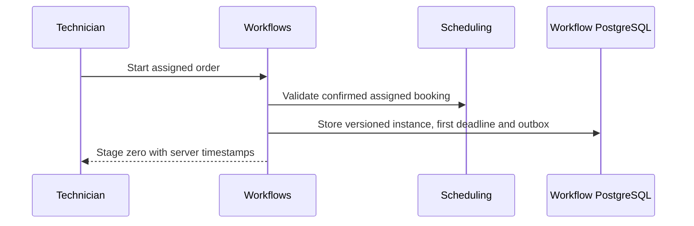

## 6. Form submission
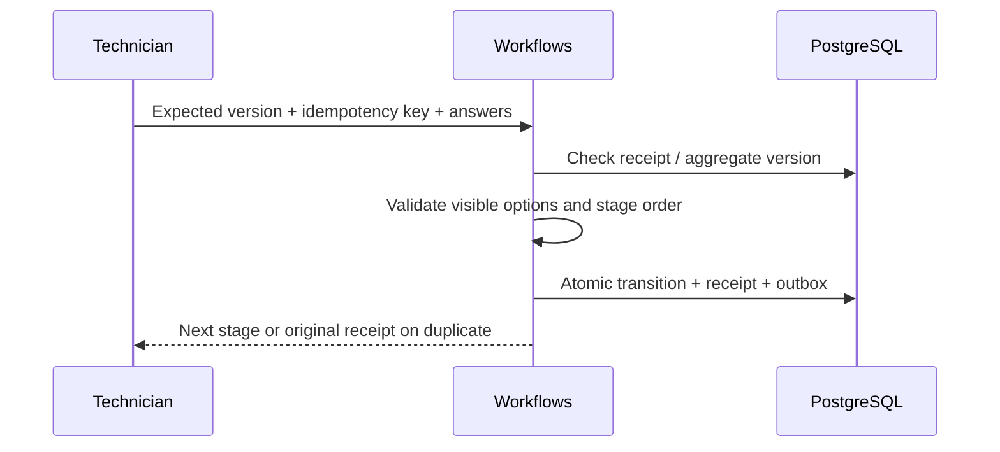

## 7. SLA warning
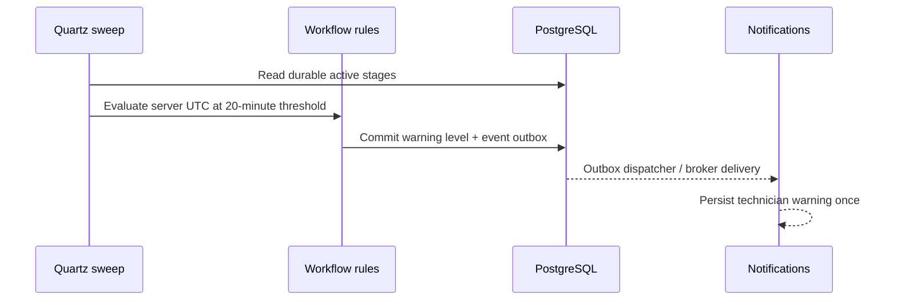

## 8. SLA breach
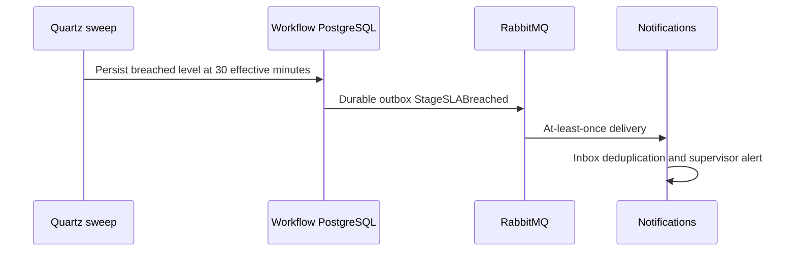

## 9. Supervisor notification
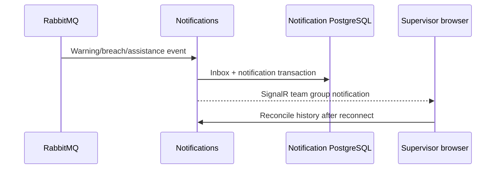

## 10. Supervisor pause approval
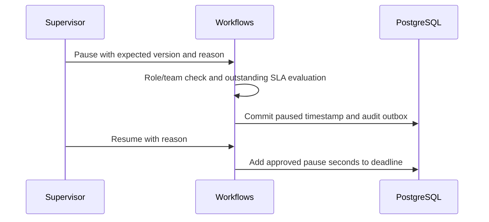

## 11. Workflow completion
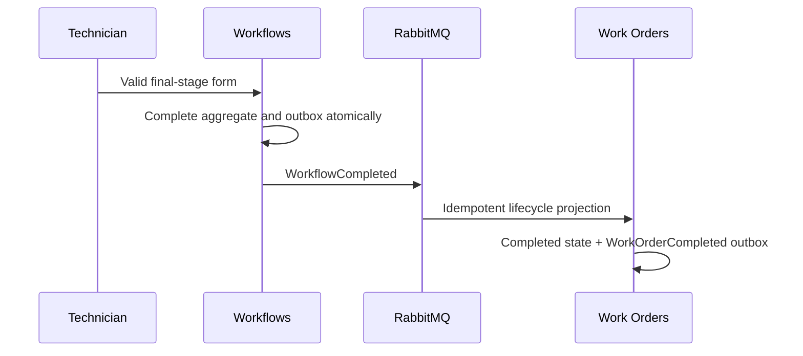

## 12. Mobile offline synchronization
```mermaid
sequenceDiagram
  participant T as Technician
  participant M as Mobile queue
  participant F as Workflows
  T->>M: Save answers while offline
  M->>M: Persist stable key/version/client time under owner namespace
  M->>F: Reconnect; submit same logical operation
  alt Version still current
    F-->>M: Committed receipt and server response time
  else Concurrent supervisor or stage change
    F-->>M: 409; preserve conflict for human review
  end
```

## 13. Warehouse ingestion
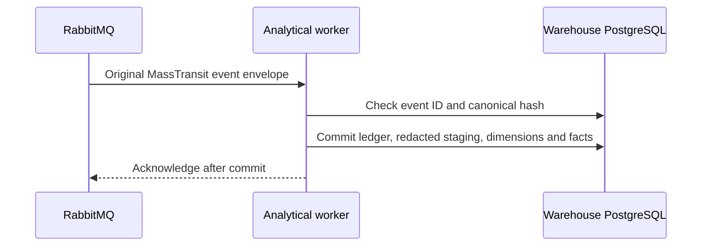

## 14. Analytics report generation
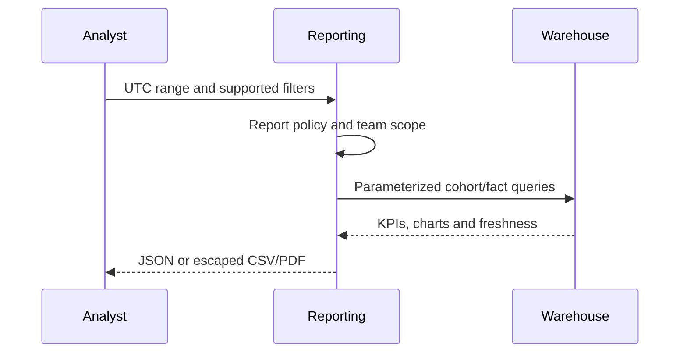

## 15. Unauthorized access
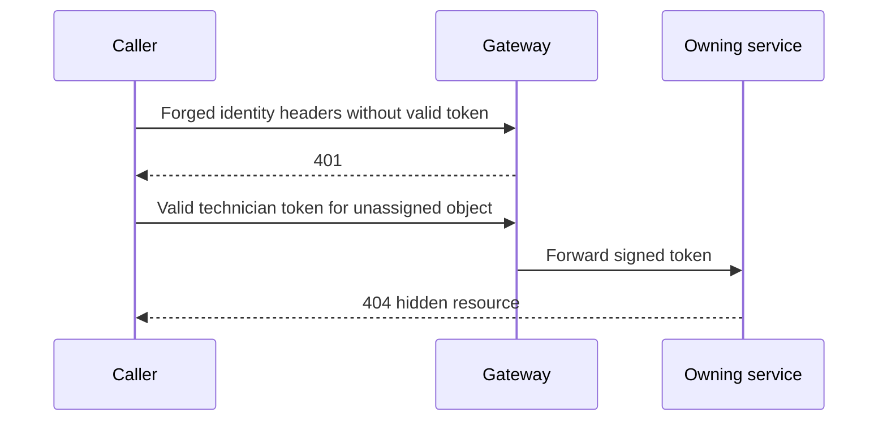

## 16. Message retry and recovery
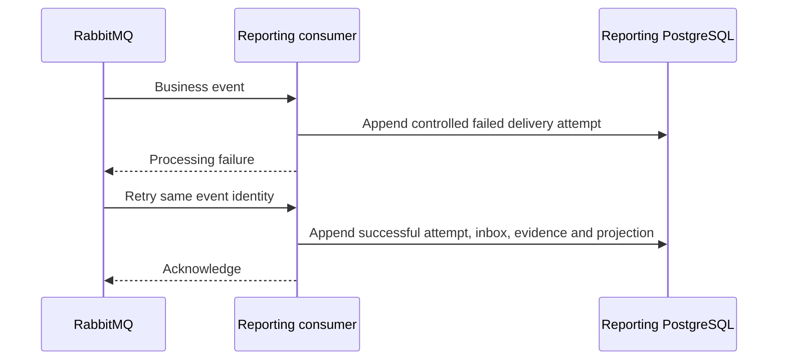

## 17. Predictive SLA inference
```mermaid
sequenceDiagram
  participant S as Supervisor
  participant G as Gateway
  participant M as Intelligence
  participant F as Workflows
  S->>G: Visible non-identifying feature values
  G->>M: Authorized private inference
  M-->>S: Synthetic calibrated probability, factors, model and limitation
  S->>F: Accept/dismiss with provenance and reason
  F->>F: Audited advisory decision; no automatic operational mutation
```

## 18. Optimization recommendation
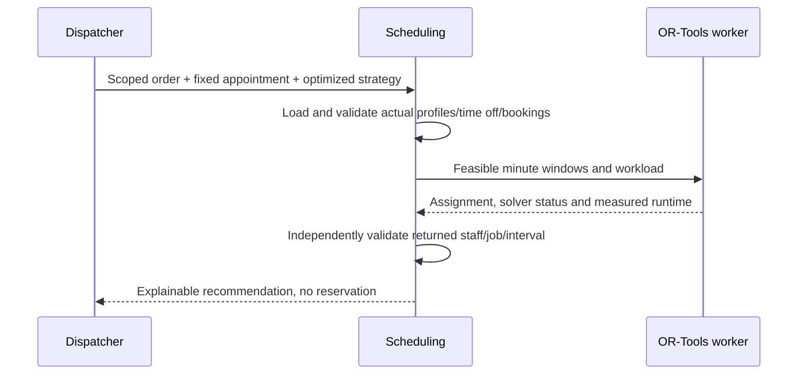

## 19. Replay ingestion
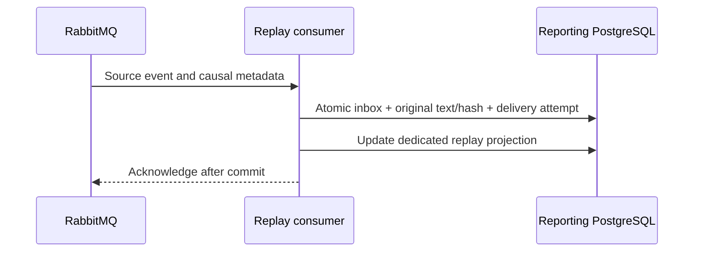

## 20. Incident reconstruction
```mermaid
sequenceDiagram
  participant S as Supervisor
  participant R as Investigation API
  participant P as Replay evidence
  S->>R: Authorized work-order investigation
  R->>P: Read team-scoped immutable events and attempts
  R->>R: Order by causation/source sequence; flag uncertainty
  R-->>S: Timeline, historical state and factual incident summary
  S->>S: Move playback cursor without issuing commands
```

## 21. Late event handling
```mermaid
sequenceDiagram
  participant B as Broker
  participant R as Replay consumer
  participant P as Evidence store
  B->>R: Late event with original occurrence timestamp
  R->>P: Append original event plus new receipt/processing timestamps
  R->>R: Rebuild order from causation and source sequence
  R-->>R: Preserve evidence, expose delay and missing-parent uncertainty
```

## 22. Trace correlation
```mermaid
sequenceDiagram
  participant U as Authorized investigator
  participant R as Replay UI
  participant J as Jaeger
  U->>R: Expand technical event details
  R->>J: Check trace identifier availability
  alt Trace retained
    R-->>U: Link to the specific trace
  else Expired or tracing unavailable
    R-->>U: Retain ID and show unavailable/retention message
  end
```
