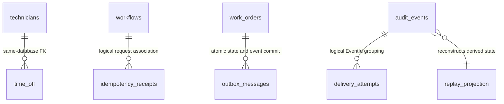
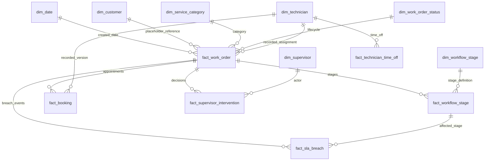
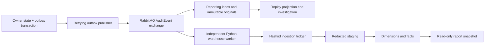

# Data architecture and schema evidence

Presentation audit date: 2026-11-05. This document describes the **current source**, including warehouse migrations 004/005 that older README/status paragraphs do not yet describe. Root confirmed both migration rows in the live warehouse ledger during presentation preparation; expanded tests still require a dated execution result. [Evidence status](EVIDENCE_MATRIX.md) distinguishes current source from historical execution.

## Database ownership and access

The local deployment uses one PostgreSQL server with independent logical databases and roles. This is database-per-service ownership, not six physical PostgreSQL servers. [Compose](../../docker-compose.yml) creates six owner/migration jobs, one warehouse migration job and distinct long-running runtime identities.

| Owner/component | Database | Main tables | Access boundary |
|---|---|---|---|
| Work Orders | fieldops_work_orders | work_orders plus common message/receipt tables | Own aggregate and lifecycle projection only |
| Technicians | fieldops_technicians | technicians, time_off plus common tables | Own profiles, qualifications, hours, team and supervisor references |
| Scheduling | fieldops_scheduling | bookings plus common tables | Authoritative confirmed appointment allocation |
| Workflows | fieldops_workflows | workflows plus common tables | Authoritative stages, deadlines, forms, receipts and versions |
| Notifications | fieldops_notifications | notifications plus common tables | Persisted alert and acknowledgment history |
| Reporting / Replay | fieldops_reporting | audit_events, delivery_attempts, replay_projection, fact_work_order, fact_workflow_stage plus common tables | Replay originals and derived local reporting state |
| Analytics worker | fieldops_warehouse | warehouse and analytics schemas described below | Independent event projection; never writes operational databases |
| Keycloak | keycloak | Identity-provider-managed schema | Identity lifecycle belongs to Keycloak |
| Reporting warehouse reader | fieldops_warehouse | SELECT on warehouse/analytics | Separate read-only connection, no analytical writes |

Common operational support tables are `outbox_messages`, `inbox_messages`, `idempotency_receipts`, plus migration ledger `fieldops_schema_migrations`. They are present in each service's generated initial schema; the existence of a table does not imply every service uses every support path.

Schema owners run versioned SQL and exit. Six `_app` roles receive necessary DML; reporting audit/delivery evidence allows SELECT/INSERT only, with UPDATE/DELETE triggers as an additional guard. Warehouse writer and reader differ. Owner/administrator access can bypass these controls, so hashes and grants do not replace independent retention/backups. Evidence: [SchemaMigrator](../../building-blocks/FieldOps.ServiceHost/SchemaMigrator.cs), [runtime grant policy](../../infrastructure/postgres/grants-warehouse-runtime.sql), [live permission verifier](../../scripts/verify-database-permissions.py).

## Operational physical model

The authoritative [initial service schemas](../../services) use quoted PascalCase columns inside lower-case table names. The following are actual physical tables, not proposed entity names.

| Table | Grain / key | Important attributes and relationships |
|---|---|---|
| work_orders | One order, UUID Id | Unique Number; customer/name/address, category/priority/status/team, optional TechnicianId, UTC creation/completion, Version |
| technicians | One profile, string Id | SupervisorId, TeamId, JSON-text SkillsJson/CertificationsJson, local hours/timezone, Available, Version |
| time_off | One exception, UUID Id | TechnicianId FK to technicians.Id after technician migration 003; positive interval, Reason, Version |
| bookings | One appointment, UUID Id | WorkOrderId and TechnicianId are service references; TeamId, UTC interval, Confirmed/Cancelled status, Version, override reason |
| workflows | One workflow per work order, UUID Id | Unique WorkOrderId; templateVersion/current index/version/status; StagesJson aggregate; UTC start/completion |
| notifications | One notification, UUID Id | Unique EventId, order/team/technician/audience, title/severity, created and acknowledgment metadata |
| outbox_messages | One stable logical outgoing event, UUID Id | JSONB Body, created/published instants, attempts, next retry, last error |
| inbox_messages | One consumer receipt, string Id | Consumer/event identity and processing timestamp |
| idempotency_receipts | One accepted logical request, string Id | ActorId, RequestHash, ResponseJson, CreatedAtUtc |
| audit_events | One original event, EventId PK | Original serialized Body text, SHA256 IntegrityHash, source/actor/order/correlation/trace, occurrence/receipt/processing timestamps |
| delivery_attempts | One observed delivery/fault, UUID Id | EventId, nullable Attempt, ConsumerService, FaultId, occurrence/receipt/processing/status/error |
| replay_projection | One derived work-order state, WorkOrderId PK | TeamId, StateJson, EventCount, UpdatedAtUtc |
| fact_work_order / fact_workflow_stage (reporting database) | Local fallback event read models | Distinct from the independent warehouse's similarly named facts |

There is no physical cross-service `assignments` table. A booking and event-driven work-order TechnicianId represent assignment. There is no separate operational `stage_transitions` or `sla_records` table: stage snapshots, pause totals and deadline/SLA fields live atomically in workflows.StagesJson, and transitions also emit audit events. Do not draw inferred cross-database foreign keys as enforced constraints.

The diagram's logical associations are deliberately labeled. Only the technician/time_off relationship shown above is an operational SQL FK; outbox/receipts/attempts use application identity and transaction rules rather than invented relational links.

## Constraints, concurrency and indexes

- [Scheduling migration 002](../../services/scheduling/migrations/002_booking_constraints.sql) uses GiST exclusion on `TechnicianId` and `tstzrange(StartUtc,EndUtc,'[)')` for Confirmed rows. Adjacent appointments may meet at one boundary. A partial unique index allows one confirmed booking per work order. Both prevent concurrent conflicts at commit.
- Workflow's unique WorkOrderId prevents multiple authoritative workflows. EF marks aggregate Version as concurrency state; expected-version commands and receipt request hashes control stale writes and retries. Receipt actor/workflow/key identity is distinct from event inbox identity.
- Outbox indexes cover published/next-attempt scans. Reporting indexes cover work order plus occurrence time, attempt EventId and nullable FaultId. Technician time-off indexes support technician/interval lookups.
- Additive service integrity migrations constrain statuses, positive versions/intervals, JSON shape and temporal consistency. Technician migration 003 adds the real same-owner FK. Reporting migration 002 adds immutable evidence triggers; migration 003 permits unknown terminal attempt totals.
- Cross-service profile edits and time-off changes can race a booking's prerequisite HTTP reads. The booking exclusion rule still protects booking overlap, but no distributed serializable transaction spans those services. Cancel booking first, wait for projection, then cancel a Scheduled order.

## Warehouse fact and dimension dictionary

[Migration 001](../../analytics/migrations/001_star_schema.sql) establishes seven conformed dimensions and five core facts. [Migration 004](../../analytics/migrations/004_technician_scd2_and_time_off.sql) adds a sixth time-off fact and SCD2 technician history. [Migration 005](../../analytics/migrations/005_database_invariants.sql) adds overlapping-history exclusion and further data guards.

| Dimension | Surrogate / natural key | Meaning and history |
|---|---|---|
| dim_date | date_key / calendar_date | UTC date attributes, valid month and weekday |
| dim_technician | technician_key / technician_id + effective epoch | Current source is SCD2: half-open effective range, current flag, hours/timezone, supervisor, skills/certifications, availability, source sequence/hash |
| dim_supervisor | supervisor_key / supervisor_id | Recorded supervisor actor/team; type-1 corrections |
| dim_customer | customer_key / customer_reference | Fixed unresolved-synthetic-reference placeholder, not customer contact data |
| dim_service_category | category_key / category | Conformed service category |
| dim_workflow_stage | stage_key / stage_index | Eight template-stage names/indices |
| dim_work_order_status | status_key / status | Conformed lifecycle status including Scheduled |

| Fact | Grain / primary key | Main relationships and measures |
|---|---|---|
| fact_work_order | One order / work_order_id | Creation date, technician/customer/category/status keys, priority/team, source status/version, creation/completion/ingestion |
| fact_workflow_stage | One stage instance / stage_instance_id | Work order/stage keys, start/deadline/completion, approved pause seconds, status/SLA/breach, last sequence |
| fact_booking | One booking / booking_id | Order/technician keys, UTC interval/status/source version |
| fact_sla_breach | One distinct breach event / event_id | Ingestion ledger, work order and stage references, occurrence time |
| fact_supervisor_intervention | One distinct intervention event / event_id | Work order/supervisor, type and occurrence time |
| fact_technician_time_off | One observed exception identity / time_off_id (unique), event_id PK | Technician identity/version, team, UTC interval/source sequence; reasons excluded |

## Ingestion, lineage, history and recovery

[worker.py](../../analytics/ingestion-worker/worker.py) stages only safelisted fields, not customer names, addresses, answers or time-off reasons. The ledger stores source/type/schema/occurrence/ingestion, canonical SHA256 and source-local sequence. Duplicate identical IDs are no-ops; changed payloads under one ID fail. Ack follows commit. Bounded retries use a durable retry queue, then an error queue.

Late authoritative Work Order versions protect metadata and terminal lifecycle. Late booking creation cannot regress a cancellation/reschedule. Missing stage starts yield unknown duration. Sequences from different services do not establish global order. SCD2 worker helpers split historical epochs, keep one current row and use source sequence for same-instant corrections. Migration 005's GiST constraint rejects overlapping epochs. Existing historical truth is limited by retained technician events: source code cannot reconstruct unobserved earlier schedules or identities.

[backfill.py](../../analytics/ingestion-worker/backfill.py) reconciles original JSONL event envelopes against ledger hashes. Default mode reads/counts; --apply validates and projects missing events in a bounded transaction. Archive completeness requires an independent manifest/operator check; matching retained hashes does not prove every original event was archived.

## Metric interpretation and caveats

Report outcome metrics select the authorized known-creation cohort in `[from,to)`, with technician/category/priority filters. SLA trend groups selected orders' stages by UTC completion date; supervisor actions group by UTC action date, which can lie outside the selected order creation window. Histogram samples require known valid times and pauses. Null rates/durations/capacity mean unknown or empty population, never a measured zero. [Query implementation](../../building-blocks/FieldOps.ServiceHost/WarehouseQueries.cs), [additional measures](../../building-blocks/FieldOps.ServiceHost/WarehouseAnalytics.cs).

Current SQL source in migration 004 calculates local-shift capacity over SCD2 epochs, excludes weekends by default, supports an include-weekends function parameter, and subtracts recorded time off. Some older metric-definition prose still says these are absent. Confirm migration deployment before presenting runtime behavior. Capacity is scheduled availability, not measured productive time. Separate overlapping time-off records currently sum clipped absence minutes then cap at shift length; this is not a general interval-union algorithm and can overstate absence. The report's public API does not expose arbitrary working calendars.

Booking utilization uses appointment overlap, independently of the creation cohort used by outcome metrics. Its numerator can include orders created earlier. A valid timezone, authoritative hours and both boundaries are necessary. A ratio above one can indicate overbooked workload; the display must not silently redefine it as a percentage already multiplied by 100.

## Quality, migrations and retention

[Quality SQL](../../analytics/quality-tests/checks.sql) checks missing/invalid relations, temporal/status consistency, duplicate booking overlap, SCD2 gaps/overlaps/current flags, unresolved time-off dimensions, ledger/staging coverage/hashes and bounded ratios. [Runner](../../analytics/quality-tests/run_checks.py) exits nonzero for returned defects. [Warehouse tests](../../tests/warehouse/test_projection.py) include late ordering, DST/cohorts, backfill, SCD2 and time-off cases; existence is distinct from a fresh execution result.

Migration ledgers and advisory locks serialize additive changes. The warehouse currently has five SQL migration files; do not repeat the stale claim that it has only three. Local Compose volumes persist on normal down/up. No production retention schedule, tested off-host backup/restore or disaster-recovery objective has been certified. Jaeger trace retention is independently bounded/in-memory and can expire while business evidence remains retained.

