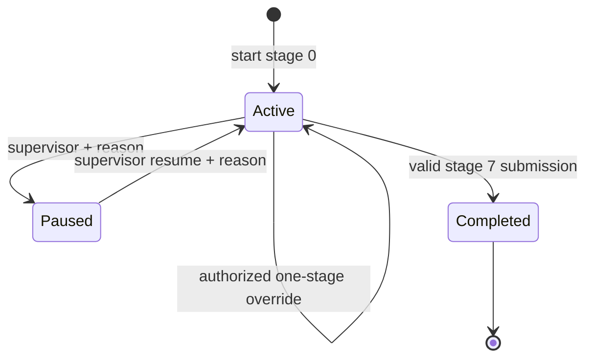

# Workflow, forms and SLA

The workflow service is the state authority. Default template version 1 contains eight named stage definitions with fixed allowed options and a conditional delay-reason field. Instances persist their template version, stage snapshots, ordered current index, authoritative start/deadline/completion timestamps, pause totals and optimistic version. Definitions currently ship with code; a runtime template publishing UI is not implemented.

Only the current stage accepts a submission. The service validates required visible fields, rejects unknown options and hidden fields, requires the expected workflow version, and saves an idempotency receipt with the resulting response. Duplicate retries return that receipt. Concurrent distinct updates conflict. Completed history is read-only. A reasoned supervisor override advances exactly one active stage and emits an audited event; it cannot fabricate a successful final completion.

Each stage defaults to 1,800 seconds, with warnings at 1,200 and 1,500 seconds and breach at 1,800. A Quartz sweep reads durable active stage state, so restarts recover outstanding deadlines. Threshold-level state, workflow version and outbox entries commit together. A late submission evaluates outstanding thresholds before completion. Supervisor pause/resume extends the persisted deadline by approved pause seconds; earlier breach evidence is retained. Assistance does not pause the clock.

Development acceleration uses validated `Sla__WarningSeconds`, `Sla__CriticalSeconds` and `Sla__DurationSeconds` environment variables. Outside `Development`, policies shorter than 30 minutes are rejected. There is no public unauthenticated clock-control endpoint. See the local demonstration override for a short, reproducible breach scenario.

Tests inject explicit clocks; no test waits 30 real minutes. Frontend countdowns are estimates and never write deadlines. Client-reported offline times remain separate from receipt and processing time.
